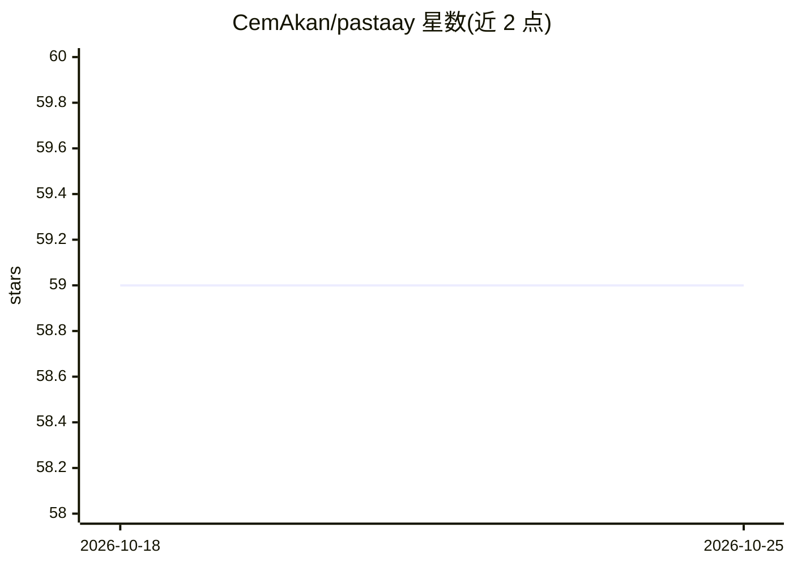

# CemAkan/pastaay

⭐ 59 · Go · MIT · 推送 2026-05-29 · [GitHub](https://github.com/CemAkan/pastaay) · 个人维护

**Go 混沌工程工具包：多协议故障注入 + AI SRE 助手**

以 Go 库形式嵌入应用的云原生混沌工程工具：对 HTTP、gRPC、Kafka、RabbitMQ、SQL、MongoDB、Redis 做拦截式故障注入，支持 CPU/内存资源损耗模拟，YAML 定义策略并带爆炸半径防护。提供 pastaayctl CLI、Kubernetes Operator（CRD）、ArgoCD/Flux GitOps 参考架构、GitHub Action 集成及内嵌 Web Console（拖拽策略构建器、实时遥测、Apdex 韧性探针）。AI 部分为 Oracle SRE 助手：接入 Gemini/Claude/GPT 分析遥测并生成混沌配置。经 go get 安装，示例用 docker compose 运行。

## 筛选速览

| 维度 | 判定 | 备注 |
|---|---|---|
| AI 角色 | `ai-enhanced` | 去掉 AI 部分产品仍成立 |
| 许可风险 | `permissive` | MIT |
| 部署形态 | `self-host` | docker 或自建部署 |
| 模型依赖 | — | README 未给出锁定关系 |
| 硬件要求 | — | 无带数字的原话,不猜 |
| 安装摩擦 | `low` | 无编译、无系统依赖或容器化 |
| 成熟度 | — | 结构信号不足 |

## 能力要点

- 7 类协议原生故障拦截与 CPU/内存资源损耗注入
- Oracle AI SRE 助手：多 LLM（Gemini/Claude/GPT）分析遥测生成混沌配置
- Kubernetes Operator CRD 与 ArgoCD/Flux GitOps 参考架构
- 内嵌 Web Console：拖拽策略构建器、实时遥测、Apdex 韧性探针

## 适用场景

- 在微服务中注入延迟、断连、级联故障验证系统韧性
- 通过 Kubernetes CRD 与 GitOps 流水线做声明式混沌实验
- 让 AI 助手根据基础设施上下文生成混沌配置
- 在 CI/CD 流水线中运行 SLA 守护的混沌实验

## 场景标签

 · 领域:云原生/可靠性工程

## 证据(README 行号)

> L12: * **Universal Interceptors:** Native fault injection for Kafka, RabbitMQ, HTTP, gRPC, SQL, MongoDB, and Redis.
> L18: * **AI SRE Copilot (Oracle):** Native multi LLM integration (Gemini, Claude, GPT) that autonomously analyzes live t

## 星数曲线

2026-10-18 59 → 2026-10-25 59（+0）

---
*卡片 v1 · prompt 1.4 · 生成 2026-10-24 · 置信度 mid · 依据 README sha `a057bccd4842` · [字段定义](../../DATASET.md)*
