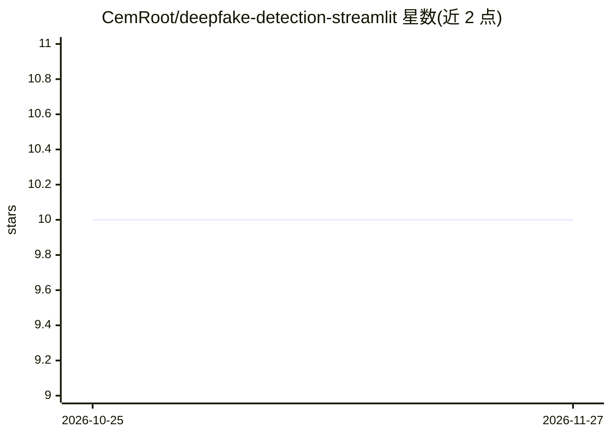

# CemRoot/deepfake-detection-streamlit

⭐ 10 · Python · MIT · 推送 2026-08-17 · [GitHub](https://github.com/CemRoot/deepfake-detection-streamlit) · [官网](https://huggingface.co/spaces/CemRoot/deepfake-detection-aics2025) · 个人维护

**面向研究者与普通用户的 AI 生成图像真伪检测 Web 应用**

基于 EfficientNetB7 加自定义空间注意力机制的深度伪造图像检测系统，对输入图像做二分类（真实/合成）并输出概率置信度，支持 JPG/JPEG/PNG，推理在普通 CPU 上 2-3 秒内返回。以 Streamlit Web 应用形式部署，另提供 Gradio 演示与 Hugging Face 上的预训练权重。为复现 AICS 2025 发表的论文而建，训练与数据集细节以论文为准；本地安装需 Python 3.10+、约 2 GB 磁盘空间。

## 筛选速览

| 维度 | 判定 | 备注 |
|---|---|---|
| AI 角色 | `ai-native` | 本体是模型或模型工具 |
| 许可风险 | `permissive` | MIT |
| 部署形态 | `library` | 以包/库形式分发 |
| 模型依赖 | — | README 未给出锁定关系 |
| 硬件要求 | — | 无带数字的原话,不猜 |
| 安装摩擦 | `low` | 无编译、无系统依赖或容器化 |
| 成熟度 | — | 结构信号不足 |

## 能力要点

- EfficientNetB7 + 自定义软空间注意力模块（约 66M 参数，2M 可训练）
- 检测 GAN（StyleGAN/ProGAN 等）与扩散模型（Stable Diffusion/DALL-E 等）生成的图像
- LIME 可解释性分析与置信度可视化
- 提供 Streamlit 与 Gradio 在线演示及预训练权重下载

## 适用场景

- 上传图片判断是否为 AI 生成
- 复现论文中的检测框架与实验结果
- 学术会议或教学场景的演示

## 场景标签

`科研工具` · 领域:学习与行业

## 证据(README 行号)

> L46: This repository contains the complete implementation deployed as an interactive web application, enabling real-time
> L87: This system provides binary classification of input images as either **authentic** (genuine photographs) or **synth
> L12: > Koyluoglu, E.C., Staikopoulos, A., Raj, K. (2026). *A Novel Deep Learning Framework for DeepFake Detection Using 

## 星数曲线

2026-10-25 10 → 2026-11-27 10（+0）

---
*卡片 v1 · prompt 1.4 · 生成 2026-11-20 · 置信度 high · 依据 README sha `f9af89b847d3` · [字段定义](../../DATASET.md)*
