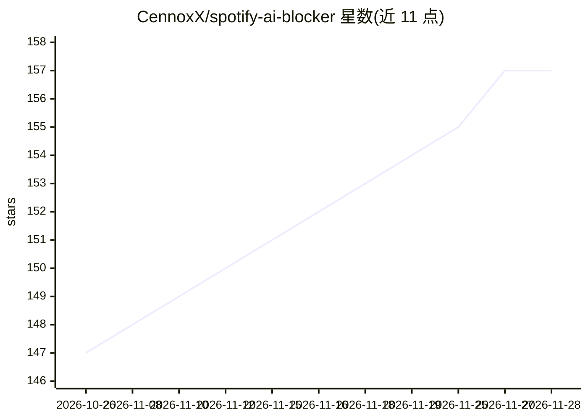

# CennoxX/spotify-ai-blocker

⭐ 157 · JavaScript · MIT · 推送 2026-11-27 · [GitHub](https://github.com/CennoxX/spotify-ai-blocker) · 个人维护

**在 Spotify 网页端自动拉黑 AI 生成音乐艺人的油猴脚本**

以 Tampermonkey/Violentmonkey 用户脚本形式运行于 Spotify Web Player：每日从 GitHub 拉取社区维护的 AI 音乐艺人 CSV 清单，钩取网页播放器内部 fetch 请求捕获访问令牌，从 localStorage 读取登录用户名，调用 Spotify 私有 API 批量拉黑清单内艺人，并记录已拉黑对象与运行日期避免重复请求。README 提示 Spotify 无官方封禁 API，脚本可能违反其服务条款。仅网页端执行封禁，封禁结果对账号全局生效。

## 筛选速览

| 维度 | 判定 | 备注 |
|---|---|---|
| AI 角色 | `ai-enhanced` | 去掉 AI 部分产品仍成立 |
| 许可风险 | `permissive` | MIT |
| 部署形态 | `None` |  |
| 模型依赖 | — | README 未给出锁定关系 |
| 硬件要求 | — | 无带数字的原话,不猜 |
| 安装摩擦 | `low` | 无编译、无系统依赖或容器化 |
| 成熟度 | — | 结构信号不足 |

## 能力要点

- 每日更新社区维护的 AI 艺人黑名单
- 钩取 Spotify 网页端内部请求自动封禁，无需手动操作
- 通过 Shift+右键匿名上报正在播放/打开的 AI 艺人
- 封禁结果在账号层面全局生效，跨设备有效

## 适用场景

- 让 Spotify 播放列表自动屏蔽 AI 生成的音乐
- 安装前先在在线清单里搜索某艺人是否为 AI 生成
- 向社区清单提交新发现的 AI 音乐艺人

## 场景标签

`工作流自动化` · 领域:效率与自动化

## 证据(README 行号)

> L8: Automatically blocks artists known for AI-generated music using a community-maintained list.
> L40: 2. **Token Capture:** Hooks into Spotify’s internal `fetch` requests to extract the access token.

## 星数曲线

2026-10-26 147 → 2026-11-28 157（+10）

---
*卡片 v1 · prompt 1.4 · 生成 2026-11-27 · 置信度 high · 依据 README sha `00eb019d62c8` · [字段定义](../../DATASET.md)*
