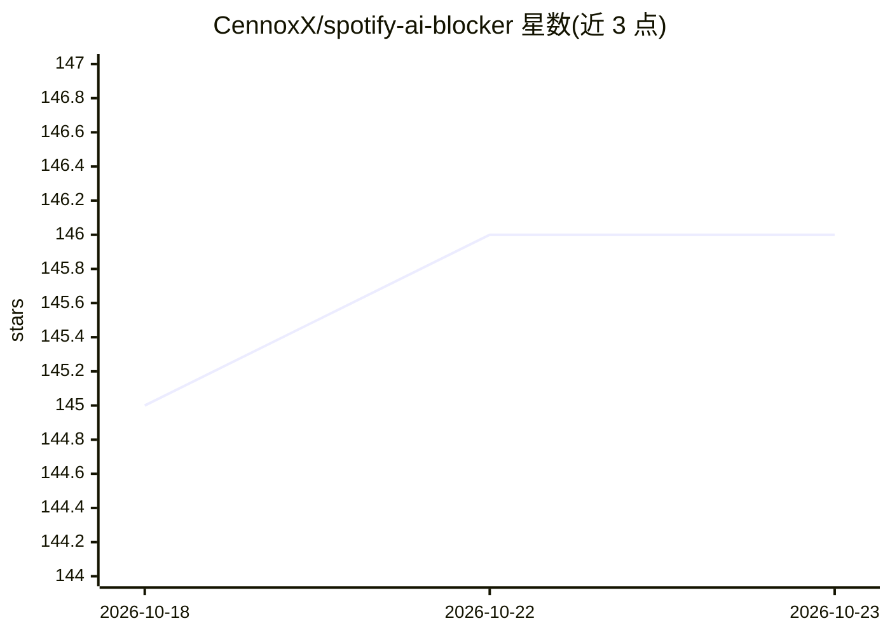

# CennoxX/spotify-ai-blocker

⭐ 146 · JavaScript · MIT · 推送 2026-10-22 · [GitHub](https://github.com/CennoxX/spotify-ai-blocker) · 个人维护

**浏览器用户脚本：自动屏蔽 Spotify 上的 AI 生成音乐艺人**

基于 Tampermonkey 的用户脚本，面向 Spotify Web Player 用户：每日从 GitHub 拉取社区维护的 AI 音乐艺人 CSV 名单，通过挂钩 Spotify 内部 fetch 请求获取访问令牌，读取 localStorage 中的用户名，调用 Spotify 私有 API 逐个屏蔽名单内艺人，并用 localStorage 记录已屏蔽艺人避免重复请求。支持在 Spotify Web 内匿名提交新发现的 AI 艺人。README 明示此方式使用非官方接口，可能违反 Spotify 服务条款。

## 筛选速览

| 维度 | 判定 | 备注 |
|---|---|---|
| AI 角色 | `ai-enhanced` | 去掉 AI 部分产品仍成立 |
| 许可风险 | `permissive` | MIT |
| 部署形态 | `None` |  |
| 模型依赖 | — | README 未给出锁定关系 |
| 硬件要求 | — | 无带数字的原话,不猜 |
| 安装摩擦 | `low` | 无编译、无系统依赖或容器化 |
| 成熟度 | — | 结构信号不足 |

## 能力要点

- 每日自动拉取社区维护的 AI 艺人 CSV 名单并批量屏蔽
- 挂钩内部 fetch 提取访问令牌，调用 Spotify 私有 API 完成屏蔽
- Shift+右键可在 Spotify Web 内匿名举报 AI 艺人
- 屏蔽结果全局生效于整个 Spotify 账户

## 适用场景

- 我不想在 Spotify 上听到 AI 生成的音乐，希望自动屏蔽相关艺人
- 发现新的 AI 艺人时向社区名单提交举报
- 仅查询某艺人是否在 AI 名单中而不安装脚本

## 场景标签

 · 领域:音乐/浏览器工具

## 证据(README 行号)

> L4: Automatically blocks artists known for AI-generated music using a community-maintained list.
> L32: 1. **List Fetching:** Daily loads a crowd-sourced CSV list of artists generating AI music from GitHub.

## 星数曲线

2026-10-18 145 → 2026-10-23 146（+1）

---
*卡片 v1 · prompt 1.4 · 生成 2026-10-22 · 置信度 high · 依据 README sha `72b77f4c7535` · [字段定义](../../DATASET.md)*
