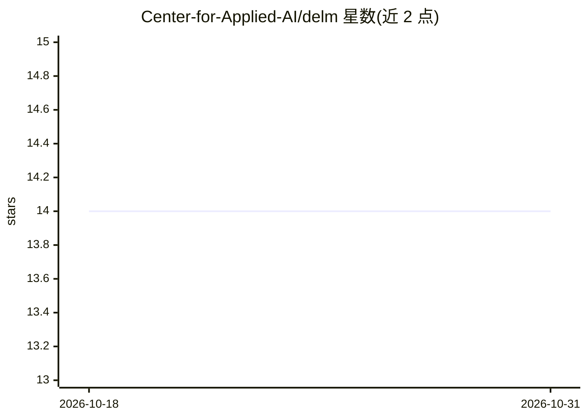

# Center-for-Applied-AI/delm

⭐ 14 · Python · MIT · 推送 2026-10-26 · [GitHub](https://github.com/Center-for-Applied-AI/delm) · [官网](https://center-for-applied-ai.github.io/delm/) · 组织维护

**用 LLM 从非结构化文本抽取结构化数据的 Python 工具包**

DELM 是 Python 工具包，构建加载→分块→打分过滤→LLM 抽取→schema 校验→评估的流水线，将 TXT/HTML/PDF/DOCX/CSV 等多种格式文档转换为结构化表数据。支持 OpenAI、Anthropic、Google、Groq、Together AI、Fireworks AI 等多种 LLM 提供方，提供简单键值、嵌套对象、多 schema 三类抽取模式。内置成本追踪、缓存、预算上限、批处理并行执行与断点续跑（checkpoint）实验管理器。面向需要批量文本抽取与标注的数据工作者和开发者，以 pip 包与 Agent Skill 两种形式交付。

## 筛选速览

| 维度 | 判定 | 备注 |
|---|---|---|
| AI 角色 | `ai-native` | 本体是模型或模型工具 |
| 许可风险 | `permissive` | MIT |
| 部署形态 | `library` | 以包/库形式分发 |
| 模型依赖 | locked-api |  |
| 硬件要求 | — | 无带数字的原话,不猜 |
| 安装摩擦 | `low` | 无编译、无系统依赖或容器化 |
| 成熟度 | — | 结构信号不足 |

## 能力要点

- 加载→分块→过滤→schema 校验抽取→评估的 checkpoint 流水线，中断可续跑
- 支持 TXT/HTML/MD/DOCX/PDF/CSV/Excel/Parquet/Feather 等 9 种输入格式
- 多 LLM 提供方接入（OpenAI/Anthropic/Google/Groq/Together/Fireworks）
- 自动成本追踪、缓存与美元预算上限
- 提供面向 coding agent 的 LLM 标注技能（skills/llm-labeling/）

## 适用场景

- 从一批 PDF/DOCX 文档中批量抽取结构化字段生成表格
- 对 CSV/Parquet 等结构化数据按 schema 做 LLM 标注与分类
- 给 coding agent 挂载 LLM 标注技能以复用该流水线

## 场景标签

`文档解析` · 领域:知识与检索

## 证据(README 行号)

> L5: DELM is a Python toolkit for extracting structured data from unstructured text using language models.
> L7:  DELM pipeline: documents are loaded, split into chunks, scored and filtered for relevance, then sent to an LLM whos
> L9:  Load → split → score → filter → extract with schema validation → evaluate, all checkpointed so interrupted runs res

## 星数曲线

2026-10-18 14 → 2026-10-31 14（+0）

---
*卡片 v1 · prompt 1.4 · 生成 2026-10-31 · 置信度 high · 依据 README sha `b4df31d79fb4` · [字段定义](../../DATASET.md)*
