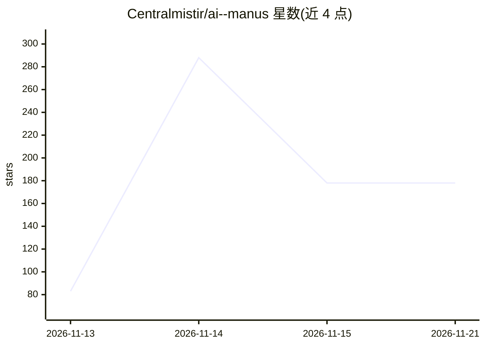

# Centralmistir/ai--manus

⭐ 178 · Apache-2.0 · 推送 2026-11-15 · [GitHub](https://github.com/Centralmistir/ai--manus) · 个人维护

**面向个人用户的自主 AI Agent，代写代码并代操作浏览器**

自称 Manus 的自主 AI Agent：用户以自然语言下达任务，agent 自行编写并执行脚本、打开网页、填写表单、完成多步操作，可在后台长期驻留并复用已学工作流。定位为家庭、学习与轻办公场景的小型助手，而非企业平台；README 声称无需编程基础即可使用。文档仅给出硬件兼容表（最低 4GB 内存、双核 CPU）与使用步骤，未提供任何具体安装命令、下载渠道或模型接入方式。

## 筛选速览

| 维度 | 判定 | 备注 |
|---|---|---|
| AI 角色 | `ai-native` | 本体是模型或模型工具 |
| 许可风险 | `permissive` | Apache-2.0 |
| 部署形态 | `None` |  |
| 模型依赖 | — | README 未给出锁定关系 |
| 硬件要求 | — | 无带数字的原话,不猜 |
| 安装摩擦 | `low` | 无编译、无系统依赖或容器化 |
| 成熟度 | — | 结构信号不足 |

## 能力要点

- 自主执行代码与控制浏览器完成多步任务
- 脚本与浏览器操作可在同一工作流中衔接
- 跨会话记忆任务模式并重复应用

## 适用场景

- 让学生整理研究资料、跑小脚本
- 让 agent 代为浏览网页、填表、收集多页信息
- 把日常重复性小任务交给后台助手处理

## 场景标签

`浏览器自动化` `编码 Agent` `AI 助手` · 领域:效率与自动化

## 证据(README 行号)

> L10: - **Autonomous Code Execution:** Manus AI agent runs code on its own to complete tasks, so you can focus on decisio
> L18: Manus is an autonomous AI agent designed to run code and control a browser on your behalf. Instead of acting like a

## 星数曲线

2026-11-13 83 → 2026-11-21 178（+95）

---
*卡片 v1 · prompt 1.4 · 生成 2026-11-17 · 置信度 mid · 依据 README sha `0f78ee3a5dd2` · [字段定义](../../DATASET.md)*
