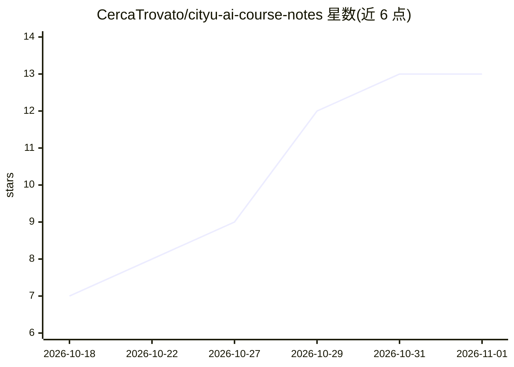

# CercaTrovato/cityu-ai-course-notes

⭐ 13 · HTML · NOASSERTION · 推送 2026-10-31 · [GitHub](https://github.com/CercaTrovato/cityu-ai-course-notes) · 个人维护 · 中文 README

**CityU 五门课中文精读笔记知识库：讲义×转录双源融合**

个人维护的 Obsidian vault，覆盖香港城市大学 MScAIB 五门课（AI 伦理、商业生成式 AI、金融科技、AI 会计、商业数据分析）。核心做法是把讲义与课堂录音 ASR 转录融合成中文精读笔记，课堂引文均带时间戳或固定页/行来源定位，禁止 AI 编造；由独立子代理两阶段审查、CAS 原子写回。截至 2026-10-31 有 48 篇笔记、55 个规范转录文本，附 EF5560 可复现代码（run_all.py 跑 15 个脚本）与规则/验收脚本。限制：讲义与转录有使用限制，笔记可能有错。

## 筛选速览

| 维度 | 判定 | 备注 |
|---|---|---|
| AI 角色 | `ai-knowledge` | 知识聚合/清单类 |
| 许可风险 | `none` | NOASSERTION |
| 部署形态 | `None` |  |
| 模型依赖 | — | README 未给出锁定关系 |
| 硬件要求 | — | 无带数字的原话,不猜 |
| 安装摩擦 | `low` | 无编译、无系统依赖或容器化 |
| 成熟度 | — | 结构信号不足 |

## 能力要点

- 48 篇中文精读笔记（38 篇 v1.0）与 55 个课堂转录文本
- 讲义×转录双源融合，引文带时间戳或固定页/行定位
- 独立子代理两阶段审查与 CAS 原子写回流程
- EF5560 提供 code/ 目录，讲义数字可重算复现

## 适用场景

- 修读同课程的同学直接读笔记、挑错、拿去修改
- 研究用大模型做长文档知识工程的规则、验收与踩坑样本
- 零基础者依据带来源的中文笔记自学课程内容

## 场景标签

`知识库管理` `教程课程` · 领域:知识与检索

## 证据(README 行号)

> L49: 这个仓库是我 2026 年 9 月开学起给自己五门课建的知识库。它是一个 Obsidian vault，我每天在用；公开出来有两个目的：一是同班或者以后修这几门课的同学可以直接读笔记、挑错、拿去改；二是它本身是我做"用 AI 建个
> L122: 所以我想做的事很具体：**把讲义和课堂转录合成一份中文精读笔记，让一个没听过课、零基础的人也能靠它自学；而且课堂引文都有来源定位：有时间戳资料逐源核时间，无时间戳第三方文字用固定物理页／行定位，不允许 AI 编造。**
> L137: |可复现代码|EF5560 的 `code/`（`run_all.py` 一键跑 15 个脚本），讲义上的数字（收益率、R²、回归系数）都能重算出来|

## 星数曲线

2026-10-18 7 → 2026-11-01 13（+6）

---
*卡片 v1 · prompt 1.4 · 生成 2026-10-31 · 置信度 mid · 依据 README sha `8c9c7588ed4c` · [字段定义](../../DATASET.md)*
