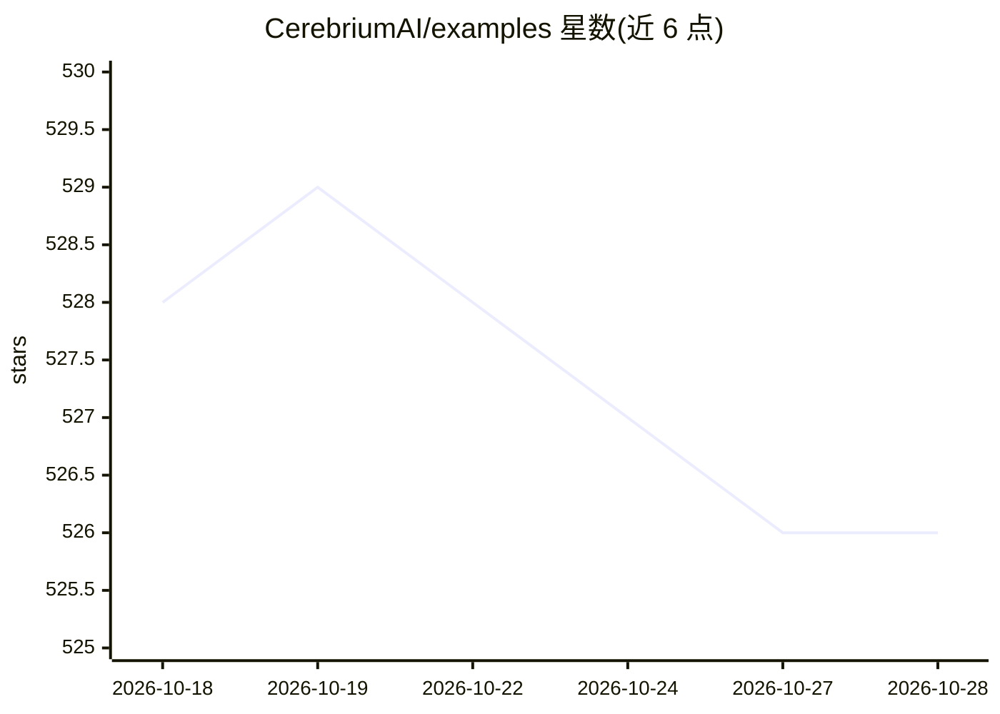

# CerebriumAI/examples

⭐ 526 · Python · 推送 2026-10-14 · [GitHub](https://github.com/CerebriumAI/examples) · [官网](https://docs.cerebrium.ai/) · 组织维护

**Cerebrium 无服务器 GPU 平台的官方示例集合**

Cerebrium（Serverless GPU 平台）官方维护的示例仓库，收录在平台上构建 ML/AI 应用的自包含示例工程，涵盖入门部署、vLLM 推理加速、多 GPU、语音（Whisper/XTTS/实时语音 agent）、图像视频（ComfyUI/SDXL/ControlNet）、LLM 端点、批处理、FastAPI/Gradio 应用等 11 个类别。每个示例含部署说明，通过克隆仓库并在示例目录运行 cerebrium deploy 命令部署；仓库开放社区贡献，被合并的 PR 可获赠品。

## 筛选速览

| 维度 | 判定 | 备注 |
|---|---|---|
| AI 角色 | `ai-knowledge` | 知识聚合/清单类 |
| 许可风险 | `none` | — |
| 部署形态 | `None` |  |
| 模型依赖 | — | README 未给出锁定关系 |
| 硬件要求 | — | 无带数字的原话,不猜 |
| 安装摩擦 | `low` | 无编译、无系统依赖或容器化 |
| 成熟度 | — | 结构信号不足 |

## 能力要点

- 11 个类别的自包含示例工程（语音/图像/LLM/批处理等）
- 每个示例附 Cerebrium 平台部署说明
- 通过 cerebrium deploy 命令部署
- 开放社区贡献并有贡献者奖励机制

## 适用场景

- 学习如何在 Serverless GPU 平台上部署各类 AI 模型
- 参考语音 agent、图像生成、LLM 端点等场景的实现
- 为公司平台部署寻找现成模板

## 场景标签

`教程课程` · 领域:学习与行业

## 证据(README 行号)

> L5: Welcome to Cerebrium's official examples repository! This collection of examples helps you get started with building
> L9: Each example is a self-contained project that demonstrates a specific use case. You can explore the examples in any 

## 星数曲线

2026-10-18 528 → 2026-10-28 526（-2）

---
*卡片 v1 · prompt 1.4 · 生成 2026-10-21 · 置信度 high · 依据 README sha `dd0196a6a1c7` · [字段定义](../../DATASET.md)*
