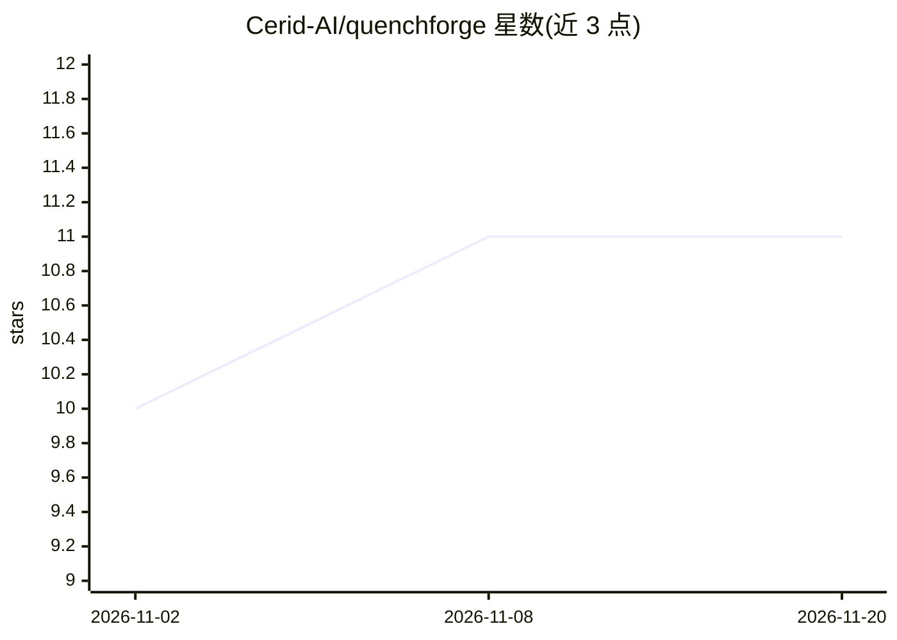

# Cerid-AI/quenchforge

⭐ 11 · Go · Apache-2.0 · 推送 2026-11-16 · [GitHub](https://github.com/Cerid-AI/quenchforge) · [官网](https://github.com/Cerid-AI/quenchforge) · 个人维护

**为 Intel Mac+AMD 独显提供本地 LLM/嵌入/重排/语音推理服务**

单一 Go 二进制，监督修补后的 llama.cpp 与 whisper.cpp 子模块，在 127.0.0.1:11434 上同时暴露 Ollama 与 OpenAI 兼容 HTTP API，支持聊天补全、嵌入、重排与语音转录槽位。针对 ggml Metal 后端在 AMD 独显上产生错误算术输出的问题，构建时对子模块应用内核正确性补丁，并按实测性能在 GPU/CPU 间分配各槽位。提供模型注册表（HuggingFace 拉取 + SHA-256 校验）、从 Ollama 导入已有模型的迁移命令、硬件预检与 Ollama 端口共存守卫。仅支持 macOS；Linux/Windows 明确不在范围内。

## 筛选速览

| 维度 | 判定 | 备注 |
|---|---|---|
| AI 角色 | `ai-ecosystem` | LLM/agent 周边工具 |
| 许可风险 | `permissive` | Apache-2.0 |
| 部署形态 | `desktop` | 安装包/桌面程序 |
| 模型依赖 | local-ok | 支持本地模型 |
| 硬件要求 | — | 无带数字的原话,不猜 |
| 安装摩擦 | `medium` | 含编译或系统依赖之一 |
| 成熟度 | — | 结构信号不足 |

## 能力要点

- Ollama + OpenAI 双兼容 API，Ollama 客户端可即插即用
- AMD Mac Metal 内核正确性补丁（llama.cpp 五个、whisper/sd/bark 各一个）
- 聊天/嵌入/代码嵌入/重排四槽位的实测式 GPU/CPU 放置策略与 VRAM 分级自适应
- quenchforge migrate-from-ollama 直接导入 ~/.ollama/models 避免重新下载

## 适用场景

- 在 Intel Mac + AMD 独显上运行正确的本地 LLM 推理
- 给已有 Ollama 客户端换后端而不改配置
- 本地批量生成嵌入与重排分数
- 在 Mac 上做本地 Whisper 转录

## 场景标签

`推理引擎` · 领域:训练与推理

## 证据(README 行号)

> L3: **Ollama for Mac users who care about correctness.** Single Go binary that supervises `llama.cpp` + `whisper.cpp`, e
> L75: |`quenchforge serve`|Supervisor + HTTP gateway. Spawns chat / embed / rerank / whisper slots as configured, fronts 
> L45: |Linux / Windows|**Out of scope**|Use stock Ollama with CUDA / ROCm / DirectML; that path is already well-served|

## 星数曲线

2026-11-02 10 → 2026-11-20 11（+1）

---
*卡片 v1 · prompt 1.4 · 生成 2026-11-19 · 置信度 high · 依据 README sha `0aa548bab30c` · [字段定义](../../DATASET.md)*
