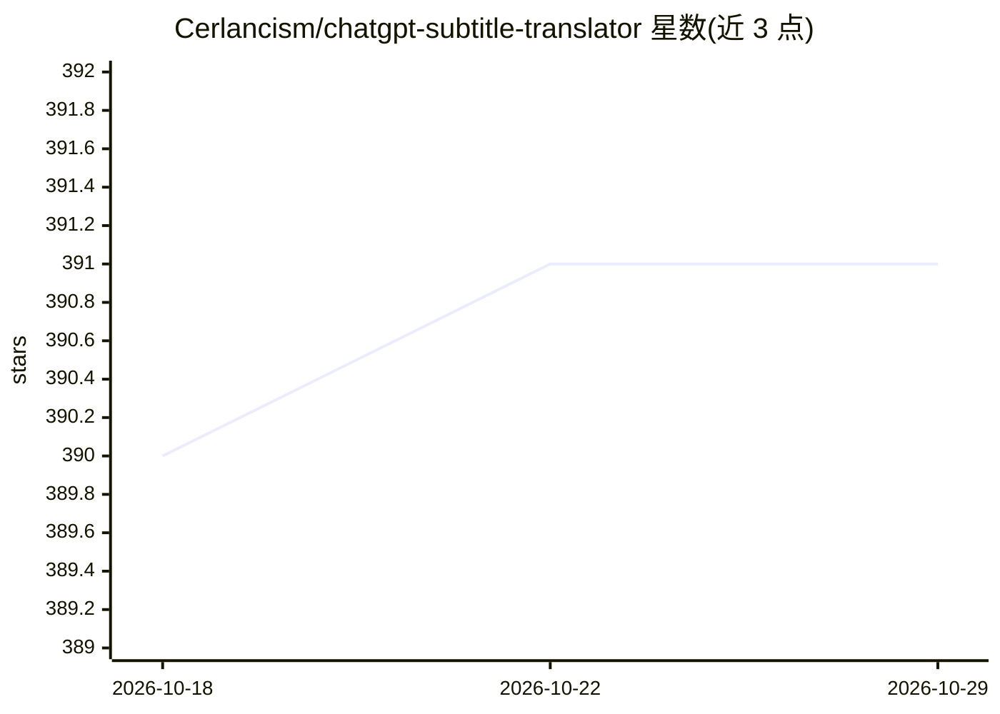

# Cerlancism/chatgpt-subtitle-translator

⭐ 391 · JavaScript · MIT · 推送 2026-10-26 · [GitHub](https://github.com/Cerlancism/chatgpt-subtitle-translator) · [官网](https://cerlancism.github.io/chatgpt-subtitle-translator/) · 个人维护

**基于 LLM API 的 SRT 字幕/逐行文本翻译工具**

调用 OpenAI ChatGPT 或任意 OpenAI 兼容 API 进行翻译的工具，面向需要翻译 SRT 字幕或纯文本的用户。核心机制：去除 SRT 格式开销并按批次分组提交，保证输入输出逐行一一对应，同时按 token 预算自动调整批大小并配合 prompt caching 降低 token 消耗；支持结构化输出、流式输出、限速与进度续传。提供 Web UI 与 CLI 两种界面，Agent 模式可先对文件做多轮概览与规划再翻译。限制：需自备 API key，依赖 Node.js >= 20 从源码安装。

## 筛选速览

| 维度 | 判定 | 备注 |
|---|---|---|
| AI 角色 | `ai-native` | 本体是模型或模型工具 |
| 许可风险 | `permissive` | MIT |
| 部署形态 | `library` | 以包/库形式分发 |
| 模型依赖 | local-ok | 支持本地模型 |
| 硬件要求 | — | 无带数字的原话,不猜 |
| 安装摩擦 | `low` | 无编译、无系统依赖或容器化 |
| 成熟度 | — | 结构信号不足 |

## 能力要点

- 去除 SRT 开销并分批翻译，保证输入输出逐行一一对应
- 按 token 预算自动调整批大小并配合 prompt caching（-c/--context）
- 支持任意 OpenAI 兼容 provider，包括本地运行的 Ollama
- Agent 模式：多轮概览（语言检测、角色/风格摘要）后生成精化翻译指令再执行

## 适用场景

- 把外语 SRT 字幕翻译成目标语言且不破坏时间轴
- 翻译纯文本文件或命令行中的短句
- 利用本地 Ollama 等兼容服务离线/低成本翻译字幕

## 场景标签

 · 领域:文本/字幕翻译工具

## 证据(README 行号)

> L4: This utility uses the OpenAI ChatGPT API to translate text, with a specific focus on line-based translation, especia
> L11: - Web User Interface (Web UI) and Command Line Interface (CLI)

## 星数曲线

2026-10-18 390 → 2026-10-29 391（+1）

---
*卡片 v1 · prompt 1.4 · 生成 2026-10-21 · 置信度 high · 依据 README sha `510a9eea4e2f` · [字段定义](../../DATASET.md)*
