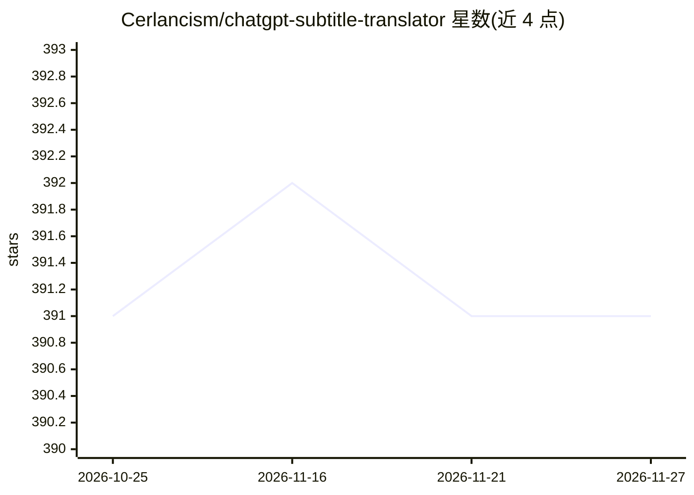

# Cerlancism/chatgpt-subtitle-translator

⭐ 391 · JavaScript · MIT · 推送 2026-11-01 · [GitHub](https://github.com/Cerlancism/chatgpt-subtitle-translator) · [官网](https://cerlancism.github.io/chatgpt-subtitle-translator/) · 个人维护

**基于 ChatGPT/OpenAI 兼容 API 的 SRT 字幕逐行翻译工具**

调用 OpenAI Chat Completion API（含 OpenAI 兼容端点）翻译 SRT 字幕与纯文本的工具，提供 Web UI 与 CLI 两种使用方式。核心机制：剥离 SRT 结构开销、将文本按行分批提交以规避单请求 token 限制，并强制输入输出逐行一一对应以保持字幕时序；支持结构化输出（array/object/timestamp/agent 模式）、prompt caching 上下文打包、RPM 限速、流式进度、断点续传与重复循环检测。需要 Node.js >= 20，通过 .env 配置 API key；Agent 模式在翻译前执行概览与规划多轮 passes。

## 筛选速览

| 维度 | 判定 | 备注 |
|---|---|---|
| AI 角色 | `ai-native` | 本体是模型或模型工具 |
| 许可风险 | `permissive` | MIT |
| 部署形态 | `library` | 以包/库形式分发 |
| 模型依赖 | local-ok | 支持本地模型 |
| 硬件要求 | — | 无带数字的原话,不猜 |
| 安装摩擦 | `low` | 无编译、无系统依赖或容器化 |
| 成熟度 | — | 结构信号不足 |

## 能力要点

- 行级分批与一一对行匹配，避免字幕时序错位
- timestamp 模式允许合并相邻条目并按时间边界校验重试
- Agent 模式：先采样生成内容概览再生成精化翻译指令
- 支持 OpenAI 兼容 API，可搭配本地 Ollama 运行

## 适用场景

- 翻译日文/中文 SRT 字幕为英文
- 批量翻译纯文本文件并断点续传
- 通过本地 Ollama 模型离线翻译字幕

## 场景标签

 · 领域:翻译/多媒体工具

## 证据(README 行号)

> L4: This utility uses the OpenAI ChatGPT API to translate text, with a specific focus on line-based translation, especia
> L14: - Supports any OpenAI API compatible providers such as running Ollama locally

## 星数曲线

2026-10-25 391 → 2026-11-27 391（+0）

---
*卡片 v1 · prompt 1.4 · 生成 2026-11-25 · 置信度 high · 依据 README sha `0c170c5c5609` · [字段定义](../../DATASET.md)*
