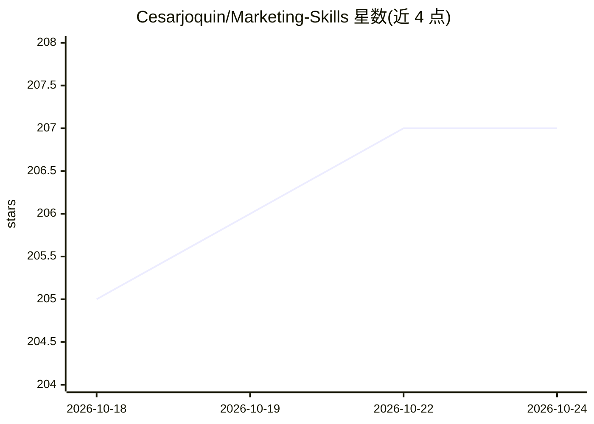

# Cesarjoquin/Marketing-Skills

⭐ 207 · TypeScript · MIT · 推送 2026-09-14 · [GitHub](https://github.com/Cesarjoquin/Marketing-Skills) · 个人维护

**面向 AI agent 的 51+ 营销技能包与 TypeScript CLI 平台**

由 51+ 个 SKILL.md 格式的 markdown 工作流（Agent Skills）与一个 TypeScript CLI 平台组成，覆盖 CRO、文案、SEO、分析、增长等领域，兼容 Claude Code、Cursor、Codex 等 Agent Skills 宿主。CLI 提供 marketing-skills 统一入口，接入 64 个营销工具（如 GA4、Apollo），可选 Redis 缓存响应，通过 REDIS_ENABLED=false 可在无 Redis 环境运行。安装方式为 git clone 源码或 npx skills add 命令。

## 筛选速览

| 维度 | 判定 | 备注 |
|---|---|---|
| AI 角色 | `ai-knowledge` | 知识聚合/清单类 |
| 许可风险 | `permissive` | MIT |
| 部署形态 | `library` | 以包/库形式分发 |
| 模型依赖 | — | README 未给出锁定关系 |
| 硬件要求 | — | 无带数字的原话,不猜 |
| 安装摩擦 | `low` | 无编译、无系统依赖或容器化 |
| 成熟度 | — | 结构信号不足 |

## 能力要点

- 51+ 个 SKILL.md 格式的营销 agent 技能，覆盖 40+ 个场景
- 统一 marketing-skills CLI，接入 64 个营销工具（GA4/Apollo 等）
- 可选 Redis 响应缓存，可通过配置禁用
- npx skills add 一键将技能安装到项目

## 适用场景

- 为 Claude Code / Cursor / Codex 等 agent 宿主添加营销工作流技能
- 工程师与技术营销人员以可复现方式执行 SEO/CRO/文案任务
- 通过 CLI 以 JSON API 方式访问外部营销工具

## 场景标签

`提示工程` · 领域:Agent 开发

## 证据(README 行号)

> L3: A production-ready toolkit for AI agents working on marketing tasks. Ships **51+ Agent Skills** (markdown workflows)
> L11: |**Agent Skills**|Spec-compliant `SKILL.md` files for Claude Code, Cursor, Codex, and other Agent Skills hosts|

## 星数曲线

2026-10-18 205 → 2026-10-24 207（+2）

---
*卡片 v1 · prompt 1.4 · 生成 2026-10-22 · 置信度 high · 依据 README sha `5519f5f281cf` · [字段定义](../../DATASET.md)*
