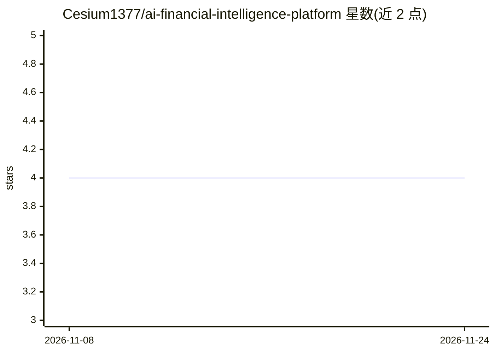

# Cesium1377/ai-financial-intelligence-platform

⭐ 4 · Python · MIT · 推送 2026-10-31 · [GitHub](https://github.com/Cesium1377/ai-financial-intelligence-platform) · 个人维护

**面向分析用户的 17 家美国上市公司财报分析仪表盘，附可选 AI 报告**

从 SEC EDGAR 抓取 17 家美国公司年报 XBRL 数据并接入 FRED 宏观数据，经映射、清洗与 9 项数据质量校验后生成增长、利润率、杠杆、现金流等财务指标，以 Streamlit 八标签仪表盘展示，支持同业对比与宏观背景分析。报告默认由确定性规则生成（无需 API key），可选接入 Claude 撰写评述并逐数字核对来源，AI 生成数字不符即丢弃草稿。附 Power BI 星型模型导出与 32 项自动化测试。

## 筛选速览

| 维度 | 判定 | 备注 |
|---|---|---|
| AI 角色 | `ai-enhanced` | 去掉 AI 部分产品仍成立 |
| 许可风险 | `permissive` | MIT |
| 部署形态 | `library` | 以包/库形式分发 |
| 模型依赖 | — | README 未给出锁定关系 |
| 硬件要求 | — | 无带数字的原话,不猜 |
| 安装摩擦 | `low` | 无编译、无系统依赖或容器化 |
| 成熟度 | — | 结构信号不足 |

## 能力要点

- SEC EDGAR XBRL 数据管道：31 个标准行项目映射 64 个 US-GAAP 概念，含完整血统记录
- 9 项数据质量校验与重述标记，问题报告而非掩盖
- 确定性报告无需 API key，可选 Claude 评述并逐数字核对，编造数字即丢弃草稿
- Power BI 星型模型 CSV 导出、37 个 DAX 度量值与构建指南

## 适用场景

- 查看并对比 17 家上市公司 15 年内的财务健康指标
- 排查财报数据质量问题与重述记录
- 在 Power BI 中基于导出的星型模型自建分析
- 生成带数字溯源的公司分析报告草稿

## 场景标签

`金融量化` `数据分析` · 领域:效率与自动化

## 证据(README 行号)

> L29:  optional AI writer can draft the commentary. Every number it uses is checked against the real
> L110: |**Reporting**|Deterministic Markdown report (no API key needed) and optional Claude commentary with a number-by-n
> L116: Python 3.12+, pandas, NumPy, Requests, Streamlit, Plotly, pytest, Ruff, Playwright (screenshots),

## 星数曲线

2026-11-08 4 → 2026-11-24 4（+0）

---
*卡片 v1 · prompt 1.4 · 生成 2026-11-21 · 置信度 high · 依据 README sha `7e56e4788cf8` · [字段定义](../../DATASET.md)*
