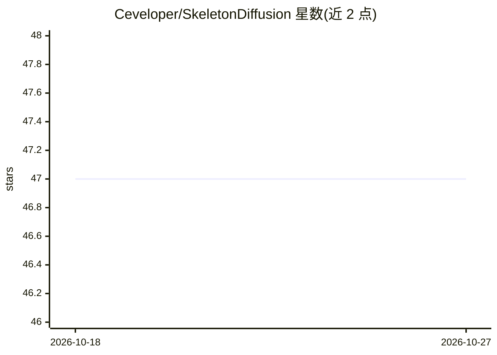

# Ceveloper/SkeletonDiffusion

⭐ 47 · Jupyter Notebook · BSD-2-Clause · 推送 2026-04-02 · [GitHub](https://github.com/Ceveloper/SkeletonDiffusion) · [官网](https://ceveloper.github.io/publications/skeletondiffusion/) · 组织维护

**CVPR 2025 论文官方代码：非各向同性高斯扩散做 3D 人体运动预测**

CVPR 2025 论文《Nonisotropic Gaussian Diffusion for Realistic 3D Human Motion Prediction》官方仓库。SkeletonDiffusion 是带注意力图架构的潜扩散模型，从过去姿态序列预测未来人体运动；训练与采样范式突破 i.i.d. 假设，将人体骨架邻接矩阵导出的关节相关性嵌入扩散过程的协方差。提供即插即用的非各向异性扩散实现（基于 lucidrains 代码库）、Hugging Face 检查点、AMASS/FreeMan/Human3.6M/3DPW 数据处理脚本、训练与评测流程。限制：扩散训练需 48GB GPU（A40），自编码器训练需 16GB GPU，评测需 24GB GPU。

## 筛选速览

| 维度 | 判定 | 备注 |
|---|---|---|
| AI 角色 | `ai-native` | 本体是模型或模型工具 |
| 许可风险 | `permissive` | BSD-2-Clause |
| 部署形态 | `None` |  |
| 模型依赖 | — | README 未给出锁定关系 |
| 硬件要求 | — | 无带数字的原话,不猜 |
| 安装摩擦 | `low` | 无编译、无系统依赖或容器化 |
| 成熟度 | — | 结构信号不足 |

## 能力要点

- 从骨架邻接矩阵提取关节相关性嵌入扩散协方差的非各向同性训练/采样范式
- 即插可用的 NonisotropicGaussianDiffusion 模块，适用于任意可用邻接矩阵描述的问题
- 提供 AMASS/AMASS-MANO/FreeMan/Human3.6M 训练与 3DPW 零样本评测脚本及 Hugging Face 检查点
- 支持以各向同性模式运行（对应论文 Table 7 消融）

## 适用场景

- 在 AMASS 等数据集上训练/评测概率式 3D 人体运动预测模型
- 用自己的姿态数据（如 RGB 提取的姿势）运行推理预测未来运动
- 将非各向同性扩散模块移植到其他由邻接矩阵描述的问题中

## 场景标签

 · 领域:计算机视觉/3D 人体运动生成

## 证据(README 行号)

> L7: This is the official repository for the CVPR 2025 paper
> L22: We address the task of Probabilistic 3D Human Motion Prediction: from the past , predict the future . Here is an ex
> L153: SkeletonDiffusion is a latent diffusion model, so it is trained in two steps.

## 星数曲线

2026-10-18 47 → 2026-10-27 47（+0）

---
*卡片 v1 · prompt 1.4 · 生成 2026-10-25 · 置信度 high · 依据 README sha `5ec5cdd9ff2a` · [字段定义](../../DATASET.md)*
