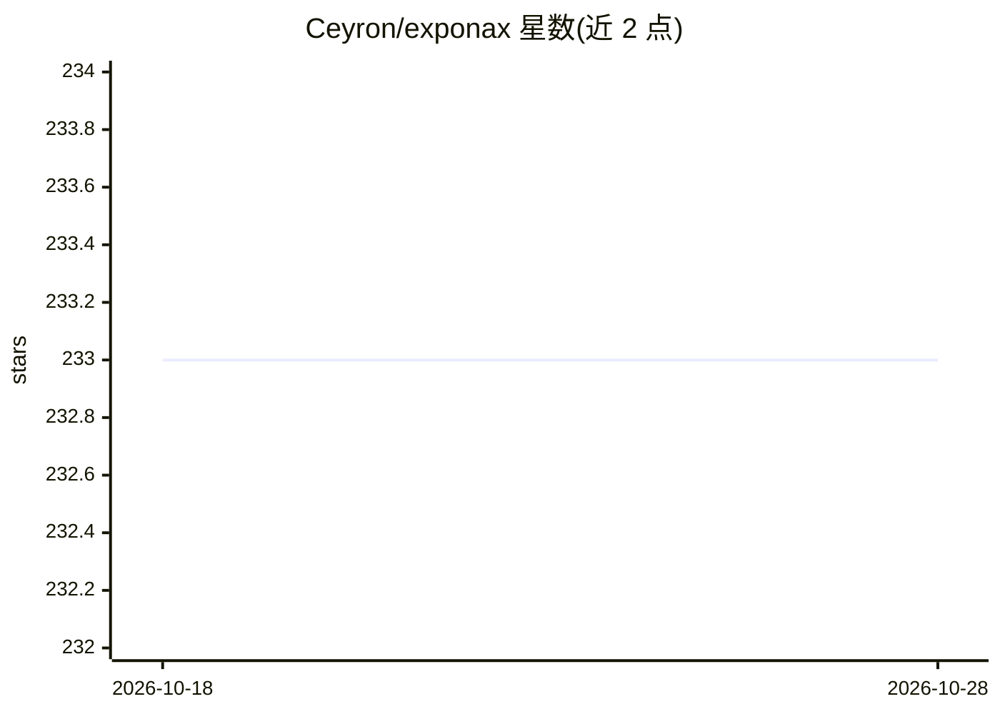

# Ceyron/exponax

⭐ 233 · Jupyter Notebook · MIT · 推送 2026-06-01 · [GitHub](https://github.com/Ceyron/exponax) · [官网](https://fkoehler.site/exponax/) · 个人维护

**科研/开发者用的可微分多维偏微分方程谱方法求解库**

基于 JAX 与 Equinox 的 1D/2D/3D 周期域偏微分方程求解库，采用傅里叶谱方法与指数时间差分（ETDRK 1-4 阶）求解半线性 PDE。内置 46 个以上求解器，覆盖线性（Advection/Diffusion/Wave）、非线性（Burgers/KdV/KS/Navier-Stokes）与反应扩散（Allen-Cahn/Gray-Scott 等）动力学，并提供通用参数化 stepper 族。每个 stepper 可自动微分、JIT 编译并支持 CPU/GPU/TPU，可直接与 jax.grad、jax.vmap 及神经网络组合，用于物理驱动的深度学习。限制：仅支持周期域与均匀笛卡尔网格。以 pip 包形式提供，需 Python 3.10+ 与 JAX 0.4.13+。

## 筛选速览

| 维度 | 判定 | 备注 |
|---|---|---|
| AI 角色 | `ai-native` | 本体是模型或模型工具 |
| 许可风险 | `permissive` | MIT |
| 部署形态 | `library` | 以包/库形式分发 |
| 模型依赖 | — | README 未给出锁定关系 |
| 硬件要求 | — | 无带数字的原话,不猜 |
| 安装摩擦 | `low` | 无编译、无系统依赖或容器化 |
| 成熟度 | — | 结构信号不足 |

## 能力要点

- 46 个以上内置 PDE 求解器（线性/非线性/反应扩散），1D/2D/3D
- 傅里叶谱方法 + ETDRK（1-4 阶），线性部分经矩阵指数精确求解
- 全部求解器可自动微分、JIT 编译、CPU/GPU/TPU 运行
- 每个 stepper 为 Equinox Module，可与神经网络组合

## 适用场景

- 为物理驱动的深度学习生成可微分 PDE 仿真数据
- 训练神经算子/神经仿真器并对其求梯度
- 批量扫描初始条件或 PDE 参数做参数化研究

## 场景标签

`科研工具` · 领域:学习与行业

## 证据(README 行号)

> L32: `Exponax` solves partial differential equations in 1D, 2D, and 3D on periodic
> L38: automatically differentiable, JIT-compilable, and GPU/TPU-ready — making it
> L130: - **Deep-learning native** — every stepper is an Equinox Module, composable with neural networks out of the box.

## 星数曲线

2026-10-18 233 → 2026-10-28 233（+0）

---
*卡片 v1 · prompt 1.4 · 生成 2026-10-22 · 置信度 high · 依据 README sha `157defffaf82` · [字段定义](../../DATASET.md)*
