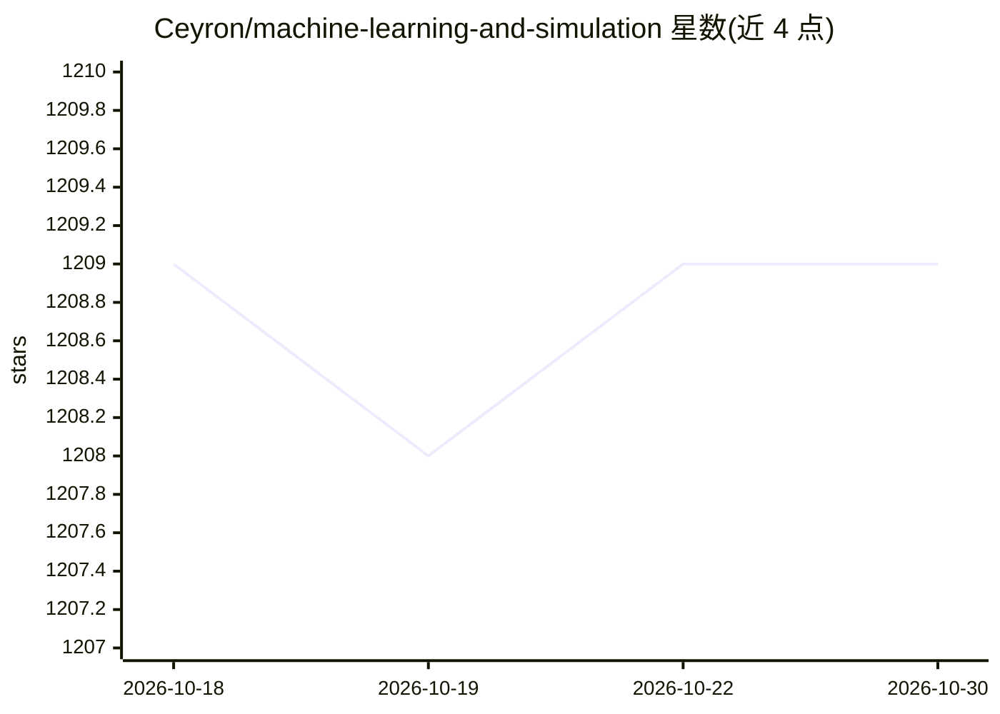

# Ceyron/machine-learning-and-simulation

⭐ 1,209 · Jupyter Notebook · MIT · 推送 2026-05-22 · [GitHub](https://github.com/Ceyron/machine-learning-and-simulation) · 个人维护

**面向 ML 与仿真的 YouTube 教学笔记与源码合集（英/德）**

个人维护的教育资源仓库，汇集其 YouTube 频道全部手写笔记与配套源代码，主题覆盖数学基础、概率分布、概率机器学习、连续介质力学、自动微分、稀疏矩阵（C 实现）、FEniCS 有限元教程、Python/Julia 仿真实现等；部分内容以德语提供（张量分析、常微分方程）。仓库同时列出未来规划主题（ODE/PDE、CFD、HPC、深度学习等）并接受 Pull-Request 贡献。内容为教学材料聚合，不提供可直接安装运行的软件产品。

## 筛选速览

| 维度 | 判定 | 备注 |
|---|---|---|
| AI 角色 | `ai-knowledge` | 知识聚合/清单类 |
| 许可风险 | `permissive` | MIT |
| 部署形态 | `None` |  |
| 模型依赖 | — | README 未给出锁定关系 |
| 硬件要求 | — | 无带数字的原话,不猜 |
| 安装摩擦 | `medium` | 含编译或系统依赖之一 |
| 成熟度 | — | 结构信号不足 |

## 能力要点

- 按播放列表组织的 10+ 个英文主题系列笔记与源码
- 德语主题：张量分析与常微分方程
- 配套 Python、Julia、C 多语言实现
- 列出未来将覆盖的 ODE/PDE、CFD、HPC 等长期主题

## 适用场景

- 系统学习机器学习与仿真所需数学基础
- 查阅稀疏矩阵、自动微分等主题的参考实现
- 查找 FEniCS 有限元与 CFD 仿真教学材料

## 场景标签

`教程课程` · 领域:学习与行业

## 证据(README 行号)

> L1: # Mathematics for Machine Learning and Simulation
> L5: Here you can find all the material of my YouTube Channel.
> L9: Most of my videos are in English but some content is also offered in German. You can find the hand-written notes in 

## 星数曲线

2026-10-18 1,209 → 2026-10-30 1,209（+0）

---
*卡片 v1 · prompt 1.4 · 生成 2026-10-21 · 置信度 high · 依据 README sha `5870bca6e17d` · [字段定义](../../DATASET.md)*
