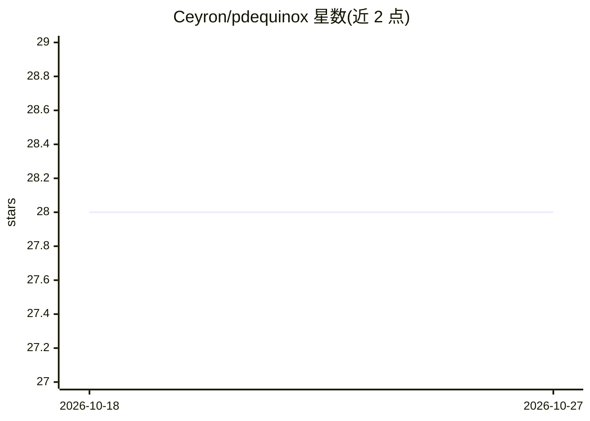

# Ceyron/pdequinox

⭐ 28 · Python · MIT · 推送 2026-08-25 · [GitHub](https://github.com/Ceyron/pdequinox) · [官网](https://fkoehler.site/pdequinox/) · 个人维护

**JAX 上的偏微分方程神经模拟器架构库**

基于 Equinox 构建的 Python 库，提供一组用于模拟偏微分方程（PDE）的神经网络架构（前馈 ConvNet、卷积 ResNet、U-Net、Dilated ResNet、Fourier Neural Operator）。架构对空间维度（1D/2D/3D）和边界条件（Dirichlet、Neumann、周期）均不敏感，边界模式直接内置在网络组件的自由度处理中。代码后端无关，可在 CPU、GPU、TPU 上运行。包为 APEBench 论文（NeurIPS 2024）的一部分，作者为 TUM 博士生，需 Python 3.10+ 与 JAX 0.4.13+。

## 筛选速览

| 维度 | 判定 | 备注 |
|---|---|---|
| AI 角色 | `ai-native` | 本体是模型或模型工具 |
| 许可风险 | `permissive` | MIT |
| 部署形态 | `library` | 以包/库形式分发 |
| 模型依赖 | — | README 未给出锁定关系 |
| 硬件要求 | — | 无带数字的原话,不猜 |
| 安装摩擦 | `low` | 无编译、无系统依赖或容器化 |
| 成熟度 | — | 结构信号不足 |

## 能力要点

- 5 类神经网络模拟器架构（ConvNet/ResNet/U-Net/Dilated ResNet/FNO）
- 维度无关（1D/2D/3D）与边界条件无关（Dirichlet/Neumann/周期）
- 基于 JAX，支持 CPU/GPU/TPU 后端无关运行
- 参数计数与感受野评估工具

## 适用场景

- 训练神经网络替代传统数值求解器模拟物理现象
- 在统一接口下对比不同 PDE 模拟器架构
- 科研场景下构建自回归神经模拟器（配合 APEBench）

## 场景标签

 · 领域:科学计算/SciML

## 证据(README 行号)

> L28: A collection of neural architectures for emulating Partial Differential Equations (PDEs) in JAX agnostic to the spa
> L54: Neural Emulators are networks learned to efficienty predict physical phenomena,

## 星数曲线

2026-10-18 28 → 2026-10-27 28（+0）

---
*卡片 v1 · prompt 1.4 · 生成 2026-10-26 · 置信度 high · 依据 README sha `f82fe45c9521` · [字段定义](../../DATASET.md)*
