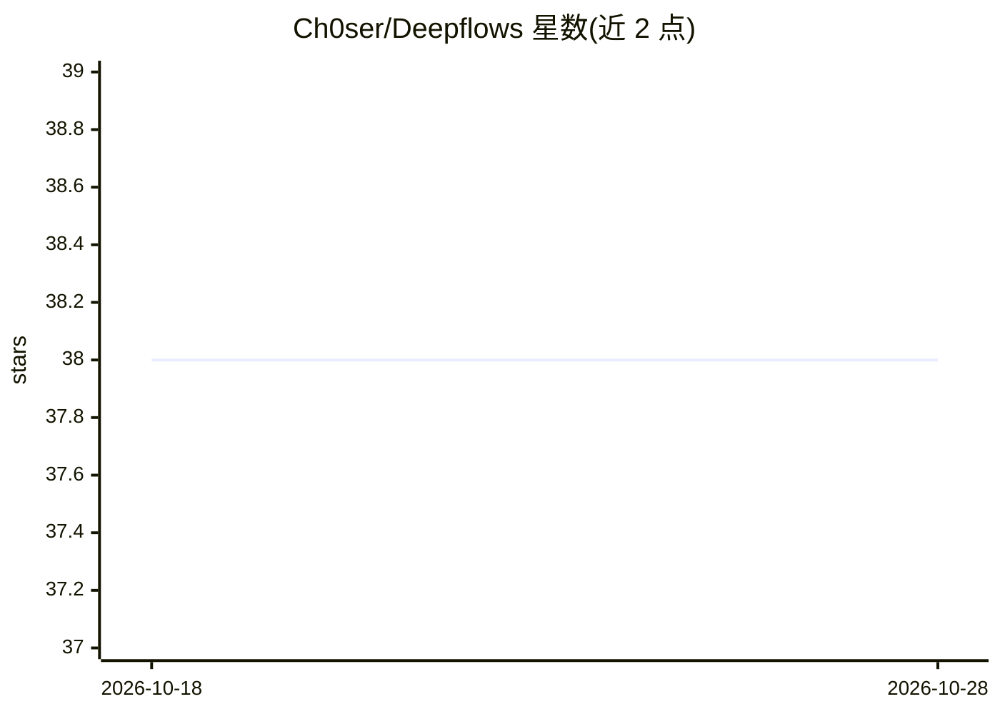

# Ch0ser/Deepflows

⭐ 38 · Python · MIT · 推送 2026-02-17 · [GitHub](https://github.com/Ch0ser/Deepflows) · 个人维护 · 中文 README

**面向教学与实验的轻量深度学习框架，含可视化平台**

自研深度学习框架：提供 Tensor 封装与计算图、自动微分（no_grad/enable_grad）、CPU/NumPy/CUDA 多后端抽象、nn 模块（Module 基类与常见层、损失函数）及 Adam/SGD/Adagrad 等优化器；支持从 PyTorch 权重转换加载 resnet18/resnet50/mobilenet_v1/vgg16 做迁移学习。CPU 模式免编译（需 Python>=3.8+NumPy），CUDA 后端需自行编译 .pyd 或导入编译产物。另附 Vue3+FastAPI 可视化平台，支持拖拽搭建模型、实时训练监控。面向深度学习教学与实验用户。

## 筛选速览

| 维度 | 判定 | 备注 |
|---|---|---|
| AI 角色 | `ai-ecosystem` | LLM/agent 周边工具 |
| 许可风险 | `permissive` | MIT |
| 部署形态 | `library` | 以包/库形式分发 |
| 模型依赖 | — | README 未给出锁定关系 |
| 硬件要求 | — | 无带数字的原话,不猜 |
| 安装摩擦 | `high` | 编译与系统依赖俱全 |
| 成熟度 | — | 结构信号不足 |

## 能力要点

- Tensor 封装、自动微分与 CPU/NumPy/CUDA 多后端抽象
- 提供 nn 模块、常见层与多种优化器（Adam/SGD/Adagrad/Adadelta 等）
- 支持从 PyTorch 转换并加载 4 种预训练视觉模型权重做迁移学习
- Vue3+FastAPI 可视化平台：拖拽搭模型、实时训练曲线与资源监控

## 适用场景

- 在课程中教学深度学习底层原理（计算图、自动微分）
- 跑 MNIST/CIFAR-10 等示例脚本做小规模训练实验
- 用可视化平台拖拽搭建网络并监控训练过程

## 场景标签

`模型训练` · 领域:训练与推理

## 证据(README 行号)

> L2:  DeepFlows is a lightweight deep learning framework for teaching and experimentation. It includes tensor encapsulati
> L13:  - `tensor.py` — Core implementation of Tensor and Computation Graph. (See `DeepFlows/tensor.py`)

## 星数曲线

2026-10-18 38 → 2026-10-28 38（+0）

---
*卡片 v1 · prompt 1.4 · 生成 2026-10-25 · 置信度 mid · 依据 README sha `55395d3a44d8` · [字段定义](../../DATASET.md)*
