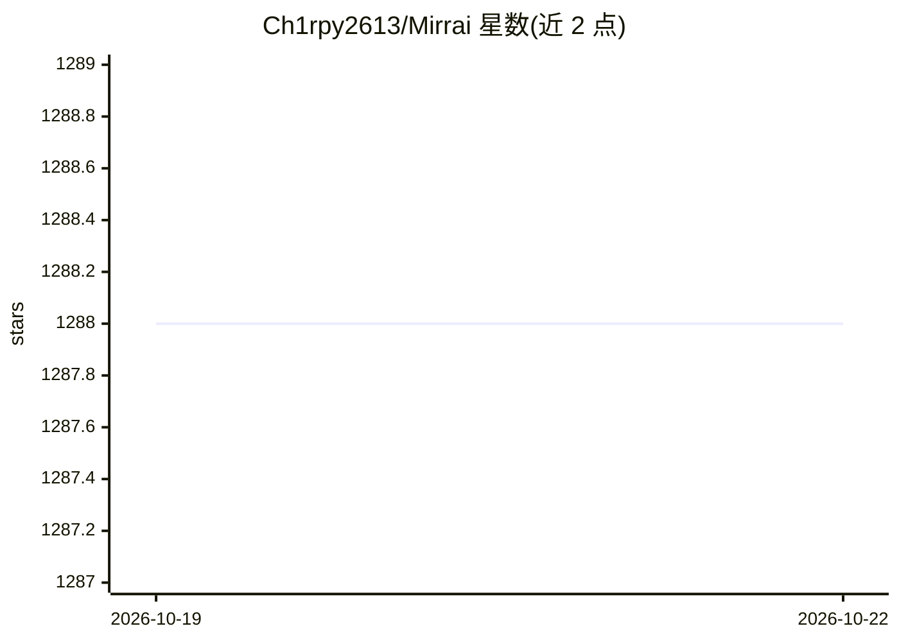

# Ch1rpy2613/Mirrai

⭐ 1,288 · TypeScript · MIT · 推送 2026-10-19 · [GitHub](https://github.com/Ch1rpy2613/Mirrai) · 个人维护 · 中文 README

**上传真实聊天记录重建数字分身的开源自托管 AI 陪伴应用**

面向个人用户的 AI 陪伴 Web 应用：上传微信聊天记录、CSV、照片等素材，经多阶段性格蒸馏 pipeline 生成含 7 层结构（性格特质、说话方式、口头禅、依恋类型等）的数字分身，用 TA 的语气回复消息。分身具有 6 种情感状态的状态机与亲密度系统，并设有「毕业机制」——检测用户情感趋于平缓后生成告别信并让分身休眠。支持 11 家 LLM 提供商（含 Ollama 完全本地推理），数据本地存储，可经 Wechaty 接入微信（非官方协议有封号风险）。TypeScript/React/Node.js 技术栈，提供 Docker、源码与 macOS DMG 三种安装方式；性格蒸馏引擎需可选的 Python 3.9+。

## 筛选速览

| 维度 | 判定 | 备注 |
|---|---|---|
| AI 角色 | `ai-native` | 本体是模型或模型工具 |
| 许可风险 | `permissive` | MIT |
| 部署形态 | `desktop` | 安装包/桌面程序 |
| 模型依赖 | local-ok | 支持本地模型 |
| 硬件要求 | — | 无带数字的原话,不猜 |
| 安装摩擦 | `low` | 无编译、无系统依赖或容器化 |
| 成熟度 | — | 结构信号不足 |

## 能力要点

- 多阶段性格蒸馏 pipeline 生成 7 层结构人设
- 6 种情感状态的状态机，随对话实时切换
- 11 家 LLM 提供商即插即用，Ollama 可完全本地推理
- 毕业机制：亲密度成长 + 告别信生成 + 分身休眠
- Wechaty 微信机器人，Web 端与微信端共享人设与记忆

## 适用场景

- 用已积累的聊天记录重建某人的数字分身继续对话
- 数据不出本地的前提下运行 AI 陪伴应用（配合 Ollama）
- 让分身在微信中自动以 TA 的语气回复联系人
- 借助毕业机制为一段关系生成告别信并归档

## 场景标签

`聊天机器人` · 领域:对话与助手

## 证据(README 行号)

> L16: 上传聊天记录，AI 重建 TA 的数字分身 — 用 TA 的语气回你消息，用 TA 的方式撒娇，知道 TA 什么时候会突然变冷漠。
> L18: 所有数据本地存储，11 家 LLM 提供商即插即用，还有一个同类产品没有的东西：**毕业机制** — 它不是让你留下，是帮你好好告别。
> L57: ### 4. 11 家 LLM 提供商即插即用
> L73: OpenAI 兼容协议共用一个适配器，通过 `baseUrl` / `model` 区分，零代码接入新服务。配合 Ollama 可实现完全本地推理，数据不出机器。

## 星数曲线

2026-10-19 1,288 → 2026-10-22 1,288（+0）

---
*卡片 v1 · prompt 1.4 · 生成 2026-10-21 · 置信度 high · 依据 README sha `064cfd2ee80f` · [字段定义](../../DATASET.md)*
