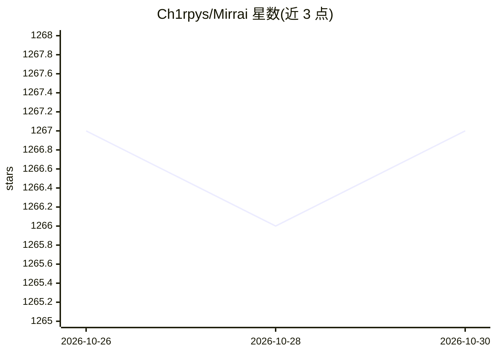

# Ch1rpys/Mirrai

⭐ 1,267 · TypeScript · MIT · 推送 2026-10-27 · [GitHub](https://github.com/Ch1rpys/Mirrai) · 个人维护 · 中文 README

**上传真实聊天记录，AI 重建熟人数字分身并陪聊的开源陪伴应用**

面向个人用户的 AI 陪伴应用：上传聊天记录、照片、视频等多源素材，经多阶段性格蒸馏 pipeline 生成包含 7 层结构的数字分身（性格、说话方式、口头禅、依恋类型等），配合 6 态情感状态机进行流式对话。支持 12 家 LLM 提供商即插即用，配合 Ollama 可完全本地推理，数据本地存储。特色机制包括亲密度成长与「毕业机制」（生成告别信后分身休眠）、判别规则挖掘、记忆召回与「像不像」评测。支持微信官方 ClawBot 与飞书通道。提供 Docker、源码及 macOS/Windows 安装包三种部署方式。使用需自行确保聊天记录使用授权。

## 筛选速览

| 维度 | 判定 | 备注 |
|---|---|---|
| AI 角色 | `ai-native` | 本体是模型或模型工具 |
| 许可风险 | `permissive` | MIT |
| 部署形态 | `desktop` | 安装包/桌面程序 |
| 模型依赖 | local-ok | 支持本地模型 |
| 硬件要求 | — | 无带数字的原话,不猜 |
| 安装摩擦 | `low` | 无编译、无系统依赖或容器化 |
| 成熟度 | — | 结构信号不足 |

## 能力要点

- 多阶段性格蒸馏生成 7 层 persona，五种蒸馏模式可选
- 6 态情感状态机随对话实时切换并影响回复语气
- 12 家 LLM 提供商即插即用，配合 Ollama 可完全本地推理
- 毕业机制：条件达成时生成告别信，分身休眠可唤醒
- 微信官方 ClawBot 与飞书长连接通道接入

## 适用场景

- 用真实聊天记录重建某个人的数字分身并与之对话
- 在数据不出本机的前提下自托管 AI 陪伴应用
- 通过微信或飞书在浏览器外与分身对话
- 完成一次有告别的陪伴体验后让分身休眠

## 场景标签

`聊天机器人` · 领域:对话与助手

## 证据(README 行号)

> L16: 上传聊天记录，AI 重建 TA 的数字分身 — 用 TA 的语气回你消息，用 TA 的方式撒娇，知道 TA 什么时候会突然变冷漠。
> L97: ### 7. 12 家 LLM 提供商即插即用
> L114: OpenAI 兼容协议共用一个适配器，通过 `baseUrl` / `model` 区分，零代码接入新服务。配合 Ollama 可实现完全本地推理，数据不出机器。

## 星数曲线

2026-10-26 1,267 → 2026-10-30 1,267（+0）

---
*卡片 v1 · prompt 1.4 · 生成 2026-10-27 · 置信度 high · 依据 README sha `60f91bd55d21` · [字段定义](../../DATASET.md)*
