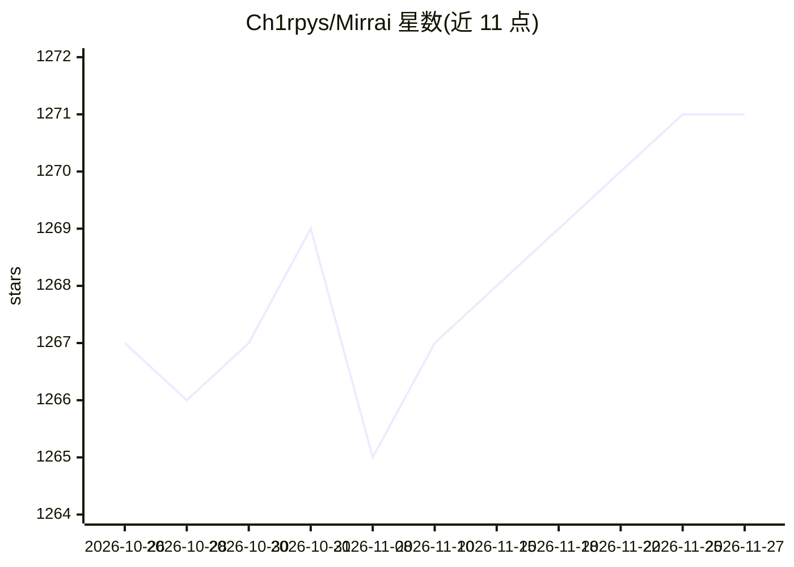

# Ch1rpys/Mirrai

⭐ 1,271 · TypeScript · MIT · 推送 2026-11-22 · [GitHub](https://github.com/Ch1rpys/Mirrai) · 个人维护 · 中文 README

**从真实聊天记录重建数字分身的自托管 AI 陪伴应用**

上传微信聊天记录（.txt/CSV/照片/视频）后，经多阶段蒸馏 pipeline 生成含 7 层结构的 persona，以分身语气进行流式对话；配套 6 态情感状态机、自动记忆抽取与召回打分、判别规则挖掘、以及以「毕业」（生成告别信后分身休眠）为设计目标的关系终点机制。技术栈为 React + tRPC + Express + PostgreSQL，数据本地存储，支持微信 ClawBot 与飞书通道接入，提供 Docker、源码、macOS/Windows 安装包四种部署方式。

## 筛选速览

| 维度 | 判定 | 备注 |
|---|---|---|
| AI 角色 | `ai-native` | 本体是模型或模型工具 |
| 许可风险 | `permissive` | MIT |
| 部署形态 | `desktop` | 安装包/桌面程序 |
| 模型依赖 | local-ok | 支持本地模型 |
| 硬件要求 | — | 无带数字的原话,不猜 |
| 安装摩擦 | `low` | 无编译、无系统依赖或容器化 |
| 成熟度 | — | 结构信号不足 |

## 能力要点

- 多阶段性格蒸馏：5 种具名模式，产出 7 层结构 persona
- 12 家 LLM 提供商适配表，OpenAI 兼容协议共用一个适配器，支持 Ollama 本地推理
- 毕业机制：亲密度成长、告别信生成、休眠/唤醒/先缓一缓状态
- 情感安全层：危机识别（本地热线）、对话过久/过密/依赖上升监测

## 适用场景

- 上传与某人的聊天记录，重建一个用 TA 语气回消息的数字分身
- 配合 Ollama 在本地完全离线运行，数据不出机器
- 通过微信 ClawBot 或飞书在聊天软件里与分身对话
- 需要时走毕业流程生成告别信，给这段体验一个终点

## 场景标签

`聊天机器人` · 领域:对话与助手

## 证据(README 行号)

> L18: 上传聊天记录，AI 重建 TA 的数字分身 — 用 TA 的语气回你消息，用 TA 的方式撒娇，知道 TA 什么时候会突然变冷漠。
> L116: OpenAI 兼容协议共用一个适配器，通过 `baseUrl` / `model` 区分，零代码接入新服务。配合 Ollama 可实现完全本地推理，数据不出机器。

## 星数曲线

2026-10-26 1,267 → 2026-11-27 1,271（+4）

---
*卡片 v1 · prompt 1.4 · 生成 2026-11-23 · 置信度 high · 依据 README sha `9350708e4405` · [字段定义](../../DATASET.md)*
