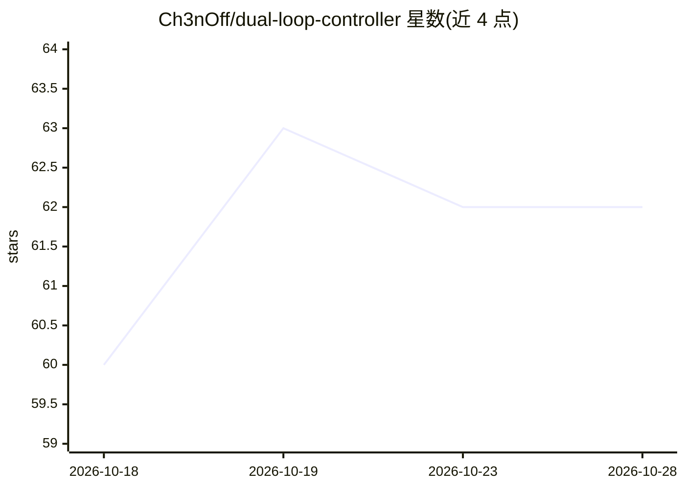

# Ch3nOff/dual-loop-controller

⭐ 62 · Python · NOASSERTION · 推送 2026-10-12 · [GitHub](https://github.com/Ch3nOff/dual-loop-controller) · 个人维护 · 中文 README

**基于 Qwen3.5-2B 的认知推理模型架构，含推理期突触可塑机制**

X-Star 2B Autonomous Brain（v4.6.0）是一个基于 Qwen3.5-2B 混合 Transformer 骨干的模型架构：将权重、记忆库与可塑路由张量融合进单一 safetensors 文件，可用标准 HuggingFace API 加载。机制包括 Layer 11 的 128 槽 VGNI 联想记忆与认知敏感门控、Layer 23 交换双组合逻辑、基于 Banach 压缩映射的稳态弹性回返，以及 cuBLAS GEMM 核优化。以 Python 包与 xstar CLI 提供，含交互聊天、基准测试与 OpenAI 兼容 REST API。基准在本地 RTX 5060 Laptop GPU 上运行 1,000 题评测。

## 筛选速览

| 维度 | 判定 | 备注 |
|---|---|---|
| AI 角色 | `ai-native` | 本体是模型或模型工具 |
| 许可风险 | `none` | NOASSERTION |
| 部署形态 | `library` | 以包/库形式分发 |
| 模型依赖 | — | README 未给出锁定关系 |
| 硬件要求 | — | 无带数字的原话,不猜 |
| 安装摩擦 | `medium` | 含编译或系统依赖之一 |
| 成熟度 | — | 结构信号不足 |

## 能力要点

- 模型权重与记忆库融合为单一 safetensors（409 张量），标准 HuggingFace API 可加载
- Layer 11 VGNI 128 槽联想记忆与动态认知敏感门控
- Banach 压缩映射约束的推理期参数可塑与稳态回返
- cuBLAS GEMM 核优化（README 报告 13.2x 微核加速）

## 适用场景

- 研究者运行 2B 级认知架构模型的推理实验
- 通过 xstar CLI 或 OpenAI 兼容 API 调用该模型
- 复现 200q/1000q 基准评测套件

## 场景标签

`模型评测` · 领域:评测与运维

## 证据(README 行号)

> L19: **X-Star 2B Autonomous Brain (v4.6.0)** represents a fundamental transition from external hooked modular controller
> L29: 1. **Endogenous Standalone Model**: The model weights, memory banks, and plastic routing tensors are 100% fused int

## 星数曲线

2026-10-18 60 → 2026-10-28 62（+2）

---
*卡片 v1 · prompt 1.4 · 生成 2026-10-24 · 置信度 mid · 依据 README sha `879e6231bde8` · [字段定义](../../DATASET.md)*
