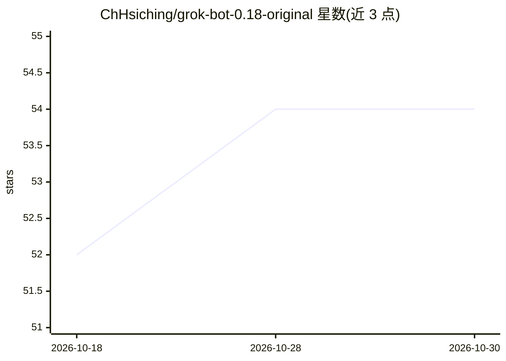

# ChHsiching/grok-bot-0.18-original

⭐ 54 · JavaScript · 推送 2026-08-30 · [GitHub](https://github.com/ChHsiching/grok-bot-0.18-original) · 个人维护

**Grok Bot 0.18.0 运行时代码的非官方归档与逐模块切分**

对 Grok Bot 0.18.0（com.anysphere.sand，构建于 2026-08-13）官方安装包中未混淆的 Electron 运行时 bundle 做机械化逐模块切分并归档：esbuild 输出保留原始类名、函数名、注释与模块路径标注，tools/split-bundles.mjs 按标注切分出 split/ 目录，split-manifest.json 记录每段声明路径、字节偏移与长度；重组后可逐字节复现官方 bundle。渲染器（前端）已压缩且无 source map，未收录。面向研究 Cursor/Grok Bot 实现的开发者，仅限学习用途，不授予代码权利。

## 筛选速览

| 维度 | 判定 | 备注 |
|---|---|---|
| AI 角色 | `ai-knowledge` | 知识聚合/清单类 |
| 许可风险 | `none` | — |
| 部署形态 | `None` |  |
| 模型依赖 | — | README 未给出锁定关系 |
| 硬件要求 | — | 无带数字的原话,不猜 |
| 安装摩擦 | `low` | 无编译、无系统依赖或容器化 |
| 成熟度 | — | 结构信号不足 |

## 能力要点

- bundle 切分重组后逐字节复现官方产物
- 切分清单记录每段声明路径、字节偏移与长度
- 提供 DMG → app.asar → bundle 的 SHA-256 校验链与复现命令
- 树内可检索模型 ID（grok-4.5、gpt-5、gemini-3.1-pro 等）与 CI 构建机路径

## 适用场景

- 研究 Grok Bot 的沙箱、Agent 协调与按模型提示词实现
- 校验官方安装包与归档内容的一致性
- 对比 0.18.0 原始代码与重构版的差异

## 场景标签

 · 领域:软件工程/代码归档

## 证据(README 行号)

> L3: Untouched runtime code from Grok Bot 0.18.0 (`com.anysphere.sand`, built 2026-08-13), mechanically split into a per-
> L7: The official installer ships its Electron runtime bundles unminified. esbuild output retains original class and func
> L32: All code under `bundles-verbatim/` and `split/` is copyright **Anysphere, Inc.** This repository is an unmodified a

## 星数曲线

2026-10-18 52 → 2026-10-30 54（+2）

---
*卡片 v1 · prompt 1.4 · 生成 2026-10-24 · 置信度 mid · 依据 README sha `c8c918945792` · [字段定义](../../DATASET.md)*
