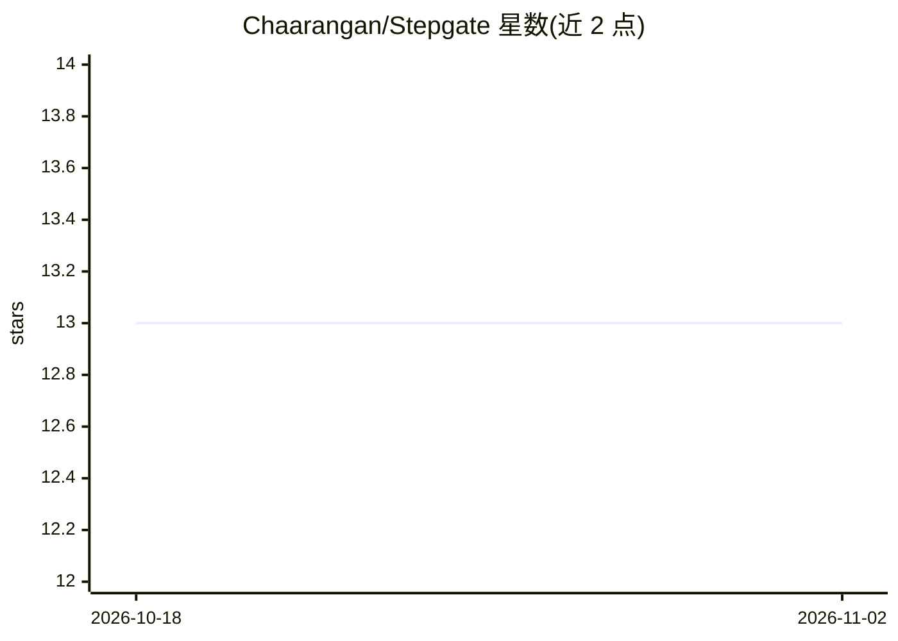

# Chaarangan/Stepgate

⭐ 13 · TypeScript · Apache-2.0 · 推送 2026-10-31 · [GitHub](https://github.com/Chaarangan/Stepgate) · [官网](https://www.npmjs.com/package/stepgate) · 个人维护

**MCP 服务器：以带闸门的步骤文件约束 agent 逐步执行流程**

以 YAML stepfile 声明 agent 流程：输入、可调用的远程 API/MCP 服务器与有序步骤；每个步骤的输出须通过 JSON Schema、JSONLogic 或 HTTP 验证器闸门才可继续，失败诊断回传模型做有限次重试。服务器代为发起全部 API 调用并持有凭证，支持人工审批闸门与哈希链式运行台账。面向在 MCP 客户端（Claude Code、Cursor、VS Code 等）上运行 agent 且跳步有代价的开发者，推理使用客户端自身模型，无需模型 API key。

## 筛选速览

| 维度 | 判定 | 备注 |
|---|---|---|
| AI 角色 | `ai-ecosystem` | LLM/agent 周边工具 |
| 许可风险 | `permissive` | Apache-2.0 |
| 部署形态 | `library` | 以包/库形式分发 |
| 模型依赖 | — | README 未给出锁定关系 |
| 硬件要求 | — | 无带数字的原话,不猜 |
| 安装摩擦 | `low` | 无编译、无系统依赖或容器化 |
| 成熟度 | — | 结构信号不足 |

## 能力要点

- 步骤按序展示，agent 无法跳步，闸门判定而非模型自述
- JSON Schema/JSONLogic/HTTP 验证器核对输出与 API 实际返回，编造值会失败
- 服务器代持凭证发起调用，拒绝 stepfile 未声明的主机
- 哈希链式运行台账，stepgate --verify 检测事后篡改

## 适用场景

- 让 agent 严格按规程执行研究、CVE 分诊等跳步有代价的流程
- 把已有 markdown runbook 转为可强制执行的 stepfile
- 在写入 Jira 等系统前经人工审批闸门确认输出

## 场景标签

`Agent 框架` `工作流自动化` · 领域:Agent 开发

## 证据(README 行号)

> L59: **Stepgate** runs stepfiles. It is an MCP server that offers each stepfile as a tool. When a client's agent calls i
> L71: - **Nothing to install on the client side.** Stepfiles call remote APIs only, and the client adds one MCP server to

## 星数曲线

2026-10-18 13 → 2026-11-02 13（+0）

---
*卡片 v1 · prompt 1.4 · 生成 2026-11-01 · 置信度 high · 依据 README sha `5c805b2b8c49` · [字段定义](../../DATASET.md)*
