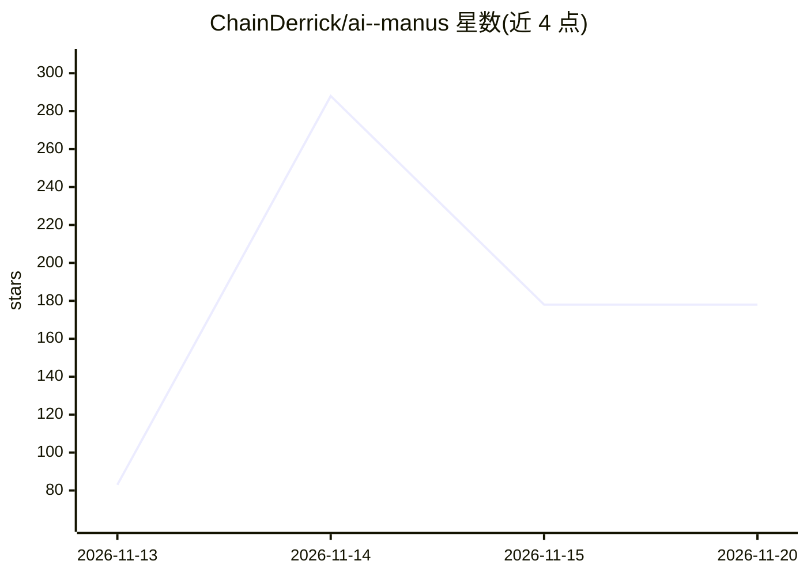

# ChainDerrick/ai--manus

⭐ 178 · Apache-2.0 · 推送 2026-11-15 · [GitHub](https://github.com/ChainDerrick/ai--manus) · 个人维护

**面向个人用户的自主 AI Agent：代为执行代码与浏览器操作**

README 描述的通用自主 AI Agent，定位为执行代码与控制浏览器的个人助手：用户以自然语言描述任务，Agent 自行编写并运行脚本、打开网页、与页面元素交互、完成多步任务，面向学习、家庭与轻量办公场景，无需编程基础。README 给出系统兼容性表（最低 4GB 内存、双核 CPU）与使用步骤说明，但未提供安装命令、源码结构或技术实现细节，仓库描述另称支持沙箱环境中运行多种工具。

## 筛选速览

| 维度 | 判定 | 备注 |
|---|---|---|
| AI 角色 | `ai-native` | 本体是模型或模型工具 |
| 许可风险 | `permissive` | Apache-2.0 |
| 部署形态 | `None` |  |
| 模型依赖 | — | README 未给出锁定关系 |
| 硬件要求 | — | 无带数字的原话,不猜 |
| 安装摩擦 | `low` | 无编译、无系统依赖或容器化 |
| 成熟度 | — | 结构信号不足 |

## 能力要点

- 自主编写并执行脚本完成多步任务
- Agent 控制浏览器：导航页面、填写表单、采集信息
- 代码执行与浏览器操作可在同一工作流中衔接
- 跨会话记忆工作模式并可重复应用

## 适用场景

- 让学生整理研究笔记、跑小型脚本
- 代替人工跨多个网页收集信息并做汇总
- 处理日常重复性小任务（文件检查、定期查页）

## 场景标签

`AI 助手` `编码 Agent` `浏览器自动化` · 领域:效率与自动化

## 证据(README 行号)

> L10: - **Autonomous Code Execution:** Manus AI agent runs code on its own to complete tasks, so you can focus on decisio
> L18: Manus is an autonomous AI agent designed to run code and control a browser on your behalf. Instead of acting like a

## 星数曲线

2026-11-13 83 → 2026-11-20 178（+95）

---
*卡片 v1 · prompt 1.4 · 生成 2026-11-17 · 置信度 low · 依据 README sha `a3d88e202bf0` · [字段定义](../../DATASET.md)*
