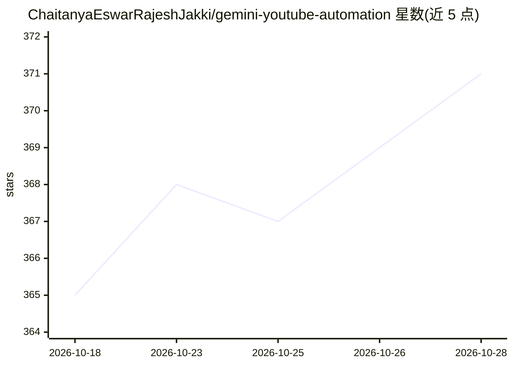

# ChaitanyaEswarRajeshJakki/gemini-youtube-automation

⭐ 371 · Python · 推送 2026-10-27 · [GitHub](https://github.com/ChaitanyaEswarRajeshJakki/gemini-youtube-automation) · [官网](https://github.com/ChaitanyaEswarRajeshJakki/gemini-youtube-automation) · 个人维护

**全自动 Python 流水线：用 Gemini 生成教学内容视频并上传 YouTube**

运行于 GitHub Actions 定时任务（每日 7:00 AM UTC）的自动化管线：读取内容计划，用 Gemini 2.5 Flash 生成多页幻灯片脚本，gTTS 合成旁白并从 Pexels 获取背景图，用 MoviePy+FFmpeg 渲染 1920×1080 横版课程视频与 1080×1920 竖版 Short，自动生成缩略图，经 YouTube Data API v3 上传并回写 content_plan.json。给想在无服务器、无人工干预条件下自动产出课程视频的开发者使用；需配置 Gemini、Pexels、YouTube OAuth 三类 API 密钥。

## 筛选速览

| 维度 | 判定 | 备注 |
|---|---|---|
| AI 角色 | `ai-native` | 本体是模型或模型工具 |
| 许可风险 | `none` | — |
| 部署形态 | `library` | 以包/库形式分发 |
| 模型依赖 | — | README 未给出锁定关系 |
| 硬件要求 | — | 无带数字的原话,不猜 |
| 安装摩擦 | `medium` | 含编译或系统依赖之一 |
| 成熟度 | — | 结构信号不足 |

## 能力要点

- Gemini 2.5 Flash 生成脚本，gTTS 旁白，Pexels 配图
- 双格式输出：横版课程视频 + 竖版 YouTube Short
- 完全运行于 GitHub Actions，无需本地机器或服务器
- 每次运行后自动回写内容计划到仓库

## 适用场景

- 定时自动产出并上传课程视频到 YouTube 频道
- 零服务器搭建每日短视频/长视频自动化生产线
- 让 AI 自动生成并扩展课程大纲

## 场景标签

`语音合成` · 领域:内容生成

## 证据(README 行号)

> L27: 2. **Writes** a full multi-slide script using Gemini 2.5 Flash
> L61: |AI Script Generation|Google Gemini 2.5 Flash|

## 星数曲线

2026-10-18 365 → 2026-10-28 371（+6）

---
*卡片 v1 · prompt 1.4 · 生成 2026-10-23 · 置信度 high · 依据 README sha `cf9d31afdaca` · [字段定义](../../DATASET.md)*
