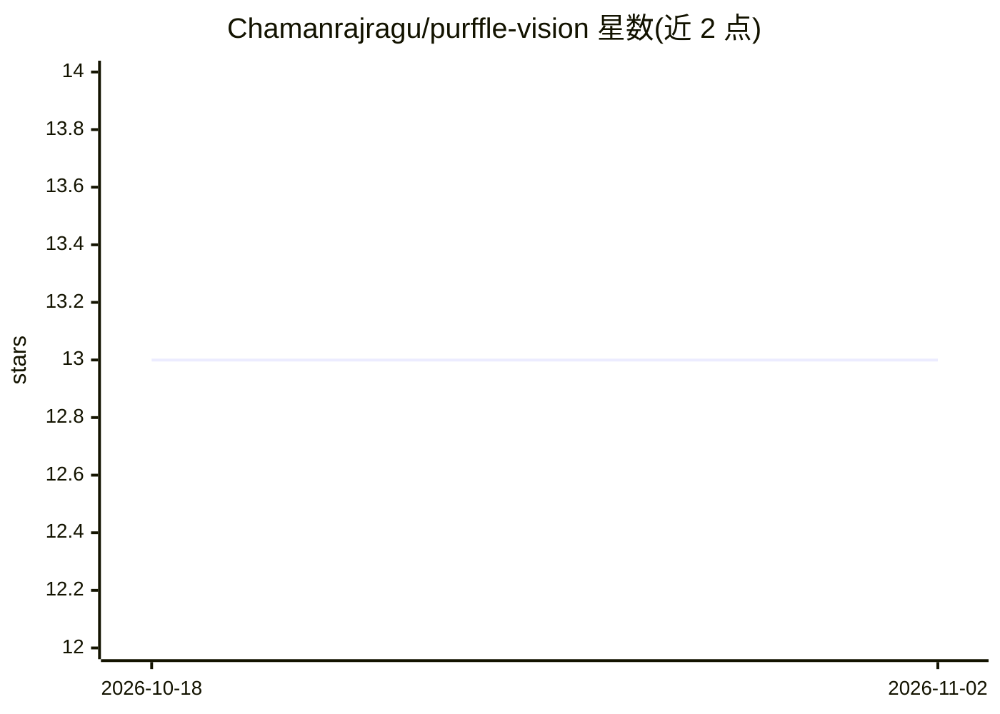

# Chamanrajragu/purffle-vision

⭐ 13 · HTML · MIT · 推送 2026-09-13 · [GitHub](https://github.com/Chamanrajragu/purffle-vision) · [官网](https://purffle.com/purffle-vision/) · 个人维护

**从任意主题自动生成 YouTube 视频的 Flask 平台**

基于 Python/Flask 的视频生成 Web 应用：输入一个主题，经 OpenAI GPT 生成脚本、gTTS 合成 50+ 语言配音、从 Pexels 抓取素材或用 DALL-E 生成图像，再由 MoviePy + ImageMagick 合成带字幕的 MP4，支持 OAuth 2.0 直接上传 YouTube。面向内容创作者、YouTuber 和营销人员。运行需自备 OpenAI 与 Pexels API key，系统需安装 ImageMagick。属 Purffle 工具集的一部分。

## 筛选速览

| 维度 | 判定 | 备注 |
|---|---|---|
| AI 角色 | `ai-native` | 本体是模型或模型工具 |
| 许可风险 | `permissive` | MIT |
| 部署形态 | `desktop` | 安装包/桌面程序 |
| 模型依赖 | — | README 未给出锁定关系 |
| 硬件要求 | — | 无带数字的原话,不猜 |
| 安装摩擦 | `low` | 无编译、无系统依赖或容器化 |
| 成熟度 | — | 结构信号不足 |

## 能力要点

- 五步流水线：GPT 脚本 → gTTS 配音 → 素材获取 → MoviePy 合成 → MP4 导出/上传
- 配音支持 50+ 语言
- 双视觉模式：Pexels 素材或 DALL-E 生成图像
- OAuth 2.0 集成直接发布到 YouTube 频道

## 适用场景

- 批量制作无出镜的 YouTube 视频
- 输入主题一键产出带配音和字幕的完整视频
- 自动生成多语言配音版本的视频内容

## 场景标签

`视频生成` `语音合成` `图像生成` · 领域:内容生成

## 证据(README 行号)

> L22: PurffleVision is an **AI-powered video creation platform** that turns any topic into a fully produced video. Built 
> L34: |1. **Script**|GPT writes an engaging, retention-optimized video script|OpenAI API|

## 星数曲线

2026-10-18 13 → 2026-11-02 13（+0）

---
*卡片 v1 · prompt 1.4 · 生成 2026-10-31 · 置信度 high · 依据 README sha `6af08636830c` · [字段定义](../../DATASET.md)*
