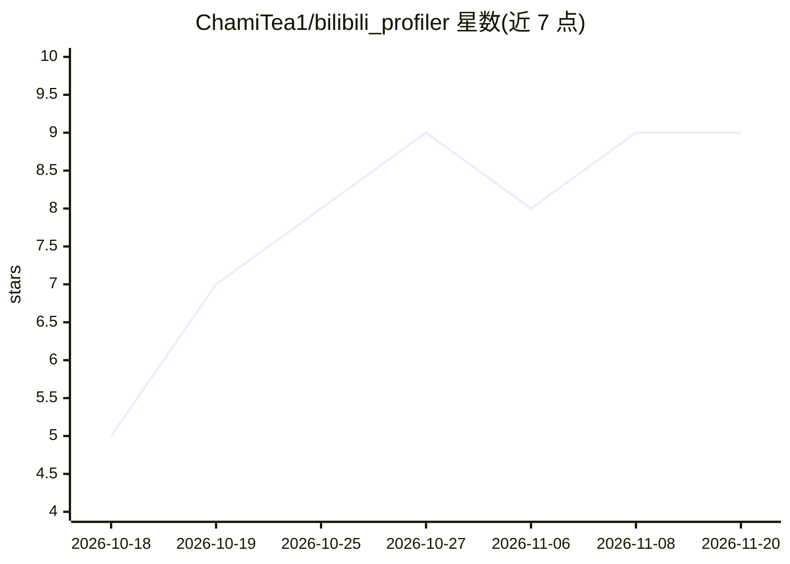

# ChamiTea1/bilibili_profiler

⭐ 9 · Python · MIT · 推送 2026-10-18 · [GitHub](https://github.com/ChamiTea1/bilibili_profiler) · [官网](chami.asia) · 个人维护 · 中文 README

**分析B站弹幕发送者画像的本地工具，含LLM判定**

输入B站视频BV号，采集弹幕与评论并按发送者聚合，通过 MITM CRC32 反查与评论/充电/互动弹幕明文交叉验证解析匿名弹幕发送者的 UID，从主页信息、互动足迹、社交关系、行为模式四个维度生成画像，并以本地 Web 服务展示八标签页报告。LLM 阶段（问题弹幕/评论判定与深掘）可配置 API Key，留空则自动跳过，采集、破解、画像仍可运行。数据存本地 SQLite，支持断点续采。需 Python 3.12+ 与扫码登录，受B站接口风控限制，大视频分析耗时为小时级。

## 筛选速览

| 维度 | 判定 | 备注 |
|---|---|---|
| AI 角色 | `ai-native` | 本体是模型或模型工具 |
| 许可风险 | `permissive` | MIT |
| 部署形态 | `None` |  |
| 模型依赖 | locked-api |  |
| 硬件要求 | — | 无带数字的原话,不猜 |
| 安装摩擦 | `low` | 无编译、无系统依赖或容器化 |
| 成熟度 | — | 结构信号不足 |

## 能力要点

- MITM CRC32 反查解析 ≤10 位 UID 匿名弹幕发送者，多源明文交叉验证并保留候选歧义
- 四维度画像与八标签页本地 Web 报告（仅监听 127.0.0.1），支持 CSV/JSON 导出
- LLM 问题判定与深掘阶段可选，不配置 Key 时完全跳过、可离线运行
- 全阶段断点续采：中断后重跑自动恢复，SQLite 持久化

## 适用场景

- 输入BV号分析某视频弹幕发送者的群体画像
- 定位跨多个视频重复出现的发送者账号
- 在无网络环境下浏览已生成报告并导出数据

## 场景标签

 · 领域:社交媒体/数据分析

## 证据(README 行号)

> L3: 输入视频BV号，深度分析发送弹幕的用户都是什么样的人。
> L145: |`LLM_API_KEY` / `LLM_MODEL` / `LLM_PROVIDER`|AI 判定与深掘；**留空则自动跳过全部 LLM 阶段**|空 / `deepseek-v4-flash` / `deepseek`（可
> L190: 不必。不配置（或留空）时，问题弹幕判定、问题评论判定、AI 深掘三个阶段自动跳过，采集、UID 破解、画像、报告全部照常；报告页对应区块显示为空态。

## 星数曲线

2026-10-18 5 → 2026-11-20 9（+4）

---
*卡片 v1 · prompt 1.4 · 生成 2026-11-20 · 置信度 high · 依据 README sha `9926b711f6b4` · [字段定义](../../DATASET.md)*
