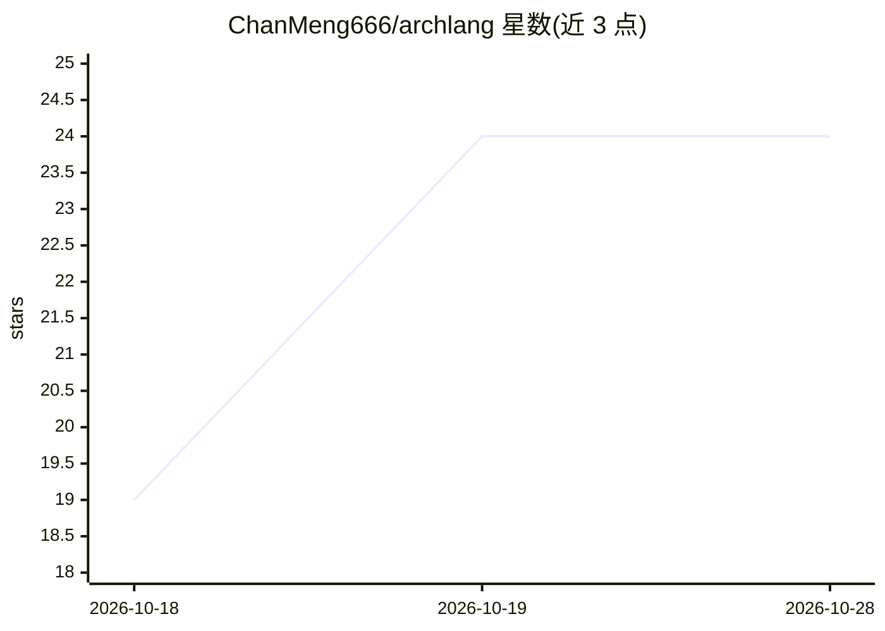

# ChanMeng666/archlang

⭐ 24 · TypeScript · MIT · 推送 2026-10-27 · [GitHub](https://github.com/ChanMeng666/archlang) · [官网](https://archlang.uk/) · 个人维护

**用文本 DSL 编写户型图并编译为 SVG/DXF/PDF 的开源编译器**

面向建筑户型图领域特定语言（DSL）与编译器：用户（或 AI coding agent）编写 .arch 纯文本源码，编译为 SVG、DXF 或 PDF 图纸，附带 lint 检查与几何校验；同一源码可逐字节复现同一图形。设计上与 coding agent 协作：提供 skills.sh 技能安装、MCP 接入命令（claude mcp add）与一键导出语言上下文（npx context），agent 可不查看图像、仅凭校验结果自查方案。以 npm 包分发，MIT 许可，是 ArchCanvas 的底层引擎。

## 筛选速览

| 维度 | 判定 | 备注 |
|---|---|---|
| AI 角色 | `ai-enhanced` | 去掉 AI 部分产品仍成立 |
| 许可风险 | `permissive` | MIT |
| 部署形态 | `library` | 以包/库形式分发 |
| 模型依赖 | — | README 未给出锁定关系 |
| 硬件要求 | — | 无带数字的原话,不猜 |
| 安装摩擦 | `low` | 无编译、无系统依赖或容器化 |
| 成熟度 | — | 结构信号不足 |

## 能力要点

- .arch 纯文本源码编译为 SVG/DXF/PDF，含 lint 与几何校验（--strict）
- 同源码逐字节确定性复现同一图形
- 面向 coding agent 的技能安装（skills add）与 MCP 接入命令（archlang-mcp）
- npx context 一条命令向 agent 输出完整语言参考

## 适用场景

- 用文本方式编写并导出精确标注尺寸的户型图
- 让 AI agent 根据自然语言需求生成 .arch 源码并自动校验修复
- 把户型图纳入代码化工作流，改一个数字仅影响对应部分

## 场景标签

 · 领域:建筑/CAD 工具

## 证据(README 行号)

> L5: Write a floor plan as text. Get a precise, dimensioned drawing back.
> L21: ArchLang compiles plain-text source into floor plans. The card shows source being typed and the drawing compiling b
> L45: - **An agent can check its own plan** without ever looking at an image.

## 星数曲线

2026-10-18 19 → 2026-10-28 24（+5）

---
*卡片 v1 · prompt 1.4 · 生成 2026-10-27 · 置信度 high · 依据 README sha `bac72a3028b8` · [字段定义](../../DATASET.md)*
