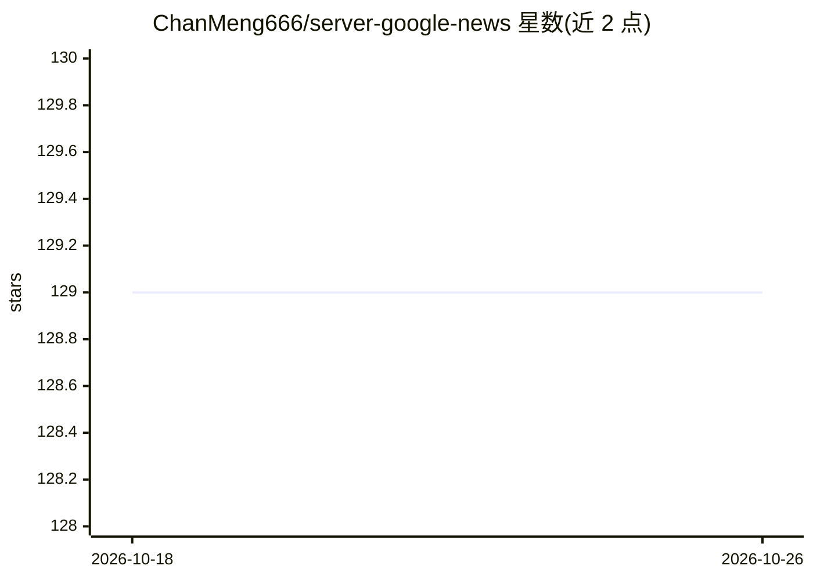

# ChanMeng666/server-google-news

⭐ 129 · TypeScript · MIT · 推送 2026-10-20 · [GitHub](https://github.com/ChanMeng666/server-google-news) · [官网](https://glama.ai/mcp/servers/dbx6imq4ef) · 个人维护

**让 Claude 等 AI 助手搜索 Google News 实时新闻的 MCP 服务器**

基于 TypeScript/Node.js 的 Model Context Protocol (MCP) 服务器，通过 SerpApi 提供单一工具 google_news_search：接收查询，返回每篇文章的标题、来源、日期、摘要与链接；文章在送达模型前先按 5 个主题（AI 与技术、商业、科学研究、医疗、综合）分组并按时间排序，支持通过 gl/hl 代码切换国家与语言（覆盖 10 种语言）。需自备 SerpApi key，配置进 claude_desktop_config.json 后由 Claude 调用；仓库以 MIT 许可发布，附面向 agent 的 llms.txt 与 docs/overview.md。

## 筛选速览

| 维度 | 判定 | 备注 |
|---|---|---|
| AI 角色 | `ai-ecosystem` | LLM/agent 周边工具 |
| 许可风险 | `permissive` | MIT |
| 部署形态 | `None` |  |
| 模型依赖 | locked-api |  |
| 硬件要求 | — | 无带数字的原话,不猜 |
| 安装摩擦 | `low` | 无编译、无系统依赖或容器化 |
| 成熟度 | — | 结构信号不足 |

## 能力要点

- 单一工具 google_news_search 返回文章标题/来源/日期/摘要/链接
- 结果在送达模型前按 5 个主题分组、按时间排序
- 通过 gl/hl 参数支持多国家多语言（10 种语言）
- 附带面向 agent 的 llms.txt 与 docs/overview.md

## 适用场景

- 在 Claude Desktop 中询问当日新闻并获得带来源链接的回答
- 让 AI 助手按主题浏览不同国家、语言的实时新闻
- 为基于 MCP 的 agent 添加新闻检索能力

## 场景标签

 · 领域:AI 工具集成/新闻检索

## 证据(README 行号)

> L9: Google News MCP Server, an open-source Model Context Protocol server that lets AI assistants such as Claude search l
> L30: - **One tool to learn.** `google_news_search` takes a query and returns each article's title, source, date, summary

## 星数曲线

2026-10-18 129 → 2026-10-26 129（+0）

---
*卡片 v1 · prompt 1.4 · 生成 2026-10-22 · 置信度 high · 依据 README sha `5750883e945f` · [字段定义](../../DATASET.md)*
