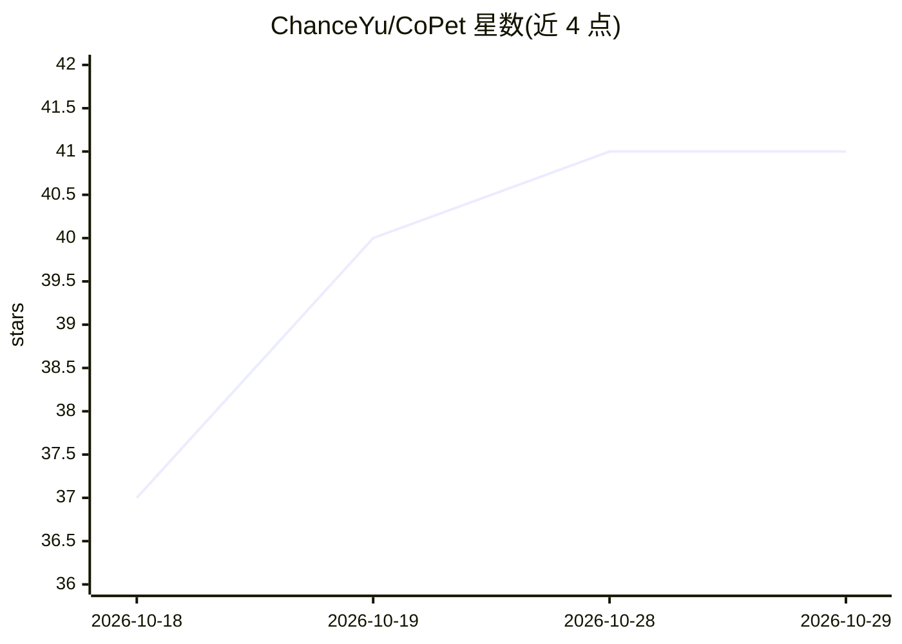

# ChanceYu/CoPet

⭐ 41 · Rust · MIT · 推送 2026-07-15 · [GitHub](https://github.com/ChanceYu/CoPet) · 个人维护 · 中文 README

**桌面宠物：实时响应 AI Agent 编码活动的伴侣应用**

基于 Tauri/Rust/React 构建的本地桌面宠物，通过 hooks/插件接入 Claude Code、Codex、Antigravity、OpenCode、Cursor、Copilot CLI、Pi、Gemini 八种 Agent，将提示词、工具调用、等待与完成状态转化为宠物动画反应。内置多款宠物，支持导入 Codex 兼容宠物包、音效包与交互（点击/长按/拖拽）。数据本地存储于 ~/.copet，无遥测；提供 macOS/Windows 安装包，也可从源码构建。

## 筛选速览

| 维度 | 判定 | 备注 |
|---|---|---|
| AI 角色 | `ai-enhanced` | 去掉 AI 部分产品仍成立 |
| 许可风险 | `permissive` | MIT |
| 部署形态 | `desktop` | 安装包/桌面程序 |
| 模型依赖 | locked-api |  |
| 硬件要求 | — | 无带数字的原话,不猜 |
| 安装摩擦 | `low` | 无编译、无系统依赖或容器化 |
| 成熟度 | — | 结构信号不足 |

## 能力要点

- 8 种 AI Agent 的 hooks/插件集成，实时反映编码活动状态
- 内置宠物 + Codex 兼容宠物包导入，附 copet-gen/copet-sound 技能生成自定义宠物
- 本地优先：数据存于 ~/.copet，事件服务器仅绑定 127.0.0.1 且需 bearer token
- 全局与单宠物音效包、系统托盘与丰富设置项

## 适用场景

- 写代码时让桌面宠物随 Agent 状态做出反应
- 把团队吉祥物或个人形象做成响应 Agent 的自定义桌面宠物
- 为 Claude Code/Codex/Cursor 等工具配置可视化活动伴侣

## 场景标签

 · 领域:开发者工具/桌面娱乐

## 证据(README 行号)

> L3:  A living desktop companion for every AI Agent.
> L40: - Real-time pet reactions to Agent prompts, tool use, waiting, completion, and errors.

## 星数曲线

2026-10-18 37 → 2026-10-29 41（+4）

---
*卡片 v1 · prompt 1.4 · 生成 2026-10-25 · 置信度 mid · 依据 README sha `dd55bc3d0004` · [字段定义](../../DATASET.md)*
