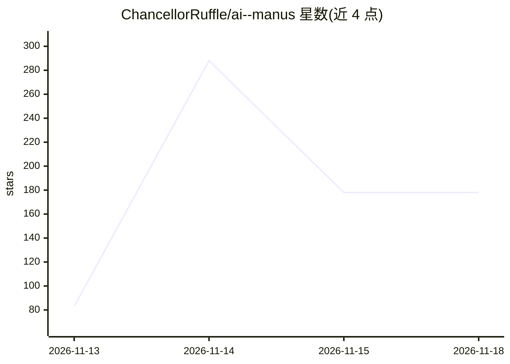

# ChancellorRuffle/ai--manus

⭐ 178 · Apache-2.0 · 推送 2026-11-15 · [GitHub](https://github.com/ChancellorRuffle/ai--manus) · 个人维护

**面向日常任务的自主 AI Agent：代写并执行代码、控制浏览器**

README 描述名为 Manus 的自主 AI Agent，宣称可代表用户执行代码、控制浏览器完成导航/填表/信息收集，并可执行多步任务与后台个人助理式工作，面向学习、家庭与轻办公等小规模场景。给出硬件兼容表（最低 4GB 内存、双核 CPU）与上手步骤说明。但 README 未提供任何安装命令、代码入口、模型接入方式或技术实现细节，仅有宣传式描述与搜索关键词列表，可验证的实现信息缺失。

## 筛选速览

| 维度 | 判定 | 备注 |
|---|---|---|
| AI 角色 | `ai-native` | 本体是模型或模型工具 |
| 许可风险 | `permissive` | Apache-2.0 |
| 部署形态 | `None` |  |
| 模型依赖 | — | README 未给出锁定关系 |
| 硬件要求 | — | 无带数字的原话,不猜 |
| 安装摩擦 | `low` | 无编译、无系统依赖或容器化 |
| 成熟度 | — | 结构信号不足 |

## 能力要点

- 宣称支持自主代码执行与浏览器控制（导航、填表、信息收集）
- 支持跨会话的多步任务执行模式
- 给出硬件兼容表（最低 4GB RAM、双核 CPU）
- 面向学习、家庭项目与轻办公场景

## 适用场景

- 让 agent 代为执行脚本与网页信息收集等重复任务
- 学习中整理研究资料与运行小脚本
- 远程办公时从多个网页汇总信息

## 场景标签

`AI 助手` `编码 Agent` `浏览器自动化` · 领域:效率与自动化

## 证据(README 行号)

> L10: - **Autonomous Code Execution:** Manus AI agent runs code on its own to complete tasks, so you can focus on decisio
> L18: Manus is an autonomous AI agent designed to run code and control a browser on your behalf. Instead of acting like a

## 星数曲线

2026-11-13 83 → 2026-11-18 178（+95）

---
*卡片 v1 · prompt 1.4 · 生成 2026-11-17 · 置信度 low · 依据 README sha `a3d88e202bf0` · [字段定义](../../DATASET.md)*
