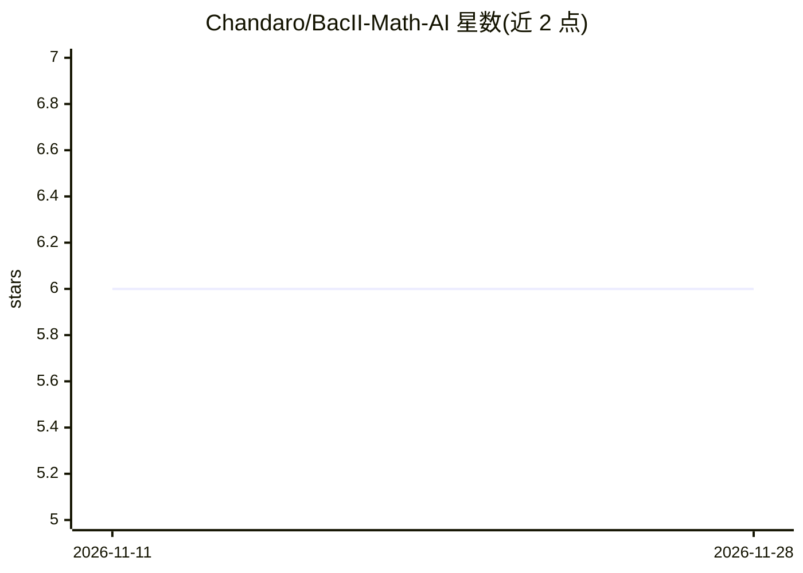

# Chandaro/BacII-Math-AI

⭐ 6 · Python · MIT · 推送 2026-11-11 · [GitHub](https://github.com/Chandaro/BacII-Math-AI) · 个人维护

**面向柬埔寨 BacII 考试的高棉语数学数据集与微调模型**

提供 108,332 条按 BacII 8 个章节组织的高棉语数学题及完整解答，答案全部由 SymPy 计算生成，非语言模型撰写；数据行含 problem/solution/answer 等字段并提供聊天微调格式。附带一个 Gemma 3 12B 的 LoRA 适配器（基于 MLX 训练，可在 Apple silicon Mac 运行）、本地聊天页面及对照数据集或 SymPy 的自动答案核对。README 声明仅供测试与研究，并给出准确率弱项说明。

## 筛选速览

| 维度 | 判定 | 备注 |
|---|---|---|
| AI 角色 | `ai-knowledge` | 知识聚合/清单类 |
| 许可风险 | `permissive` | MIT |
| 部署形态 | `library` | 以包/库形式分发 |
| 模型依赖 | — | README 未给出锁定关系 |
| 硬件要求 | — | 无带数字的原话,不猜 |
| 安装摩擦 | `low` | 无编译、无系统依赖或容器化 |
| 成熟度 | — | 结构信号不足 |

## 能力要点

- 108,332 条高棉语数学题，答案全部经 SymPy 计算验证
- 提供 Gemma 3 12B 的 LoRA 适配器，基于 MLX 在 Apple silicon 上训练与运行
- 本地聊天页面带自动答案核对（match/partial/mismatch）
- 数据按 8 个 BacII 章节的 JSONL 文件组织，附完整 schema

## 适用场景

- 为高棉语数学教育研究获取经 SymPy 验证的题目数据集
- 在自己的代码中复用答案核对模块校验模型输出
- 在 Mac 上运行本地聊天页面测试微调模型的答题效果

## 场景标签

`微调` · 领域:训练与推理

## 证据(README 行号)

> L5: A Khmer-language math dataset in the style of Cambodia's Grade 12 BacII exam, and a model adapter trained on it.
> L7: - **108,332 exercises with full worked solutions in Khmer**, math in LaTeX, across 8 BacII chapters.
> L9: - **A LoRA adapter for Gemma 3 12B** (Run 8, "Daro Dai Chav 5") that answers in Khmer BacII style. It runs on an App

## 星数曲线

2026-11-11 6 → 2026-11-28 6（+0）

---
*卡片 v1 · prompt 1.4 · 生成 2026-11-20 · 置信度 high · 依据 README sha `7189fb3d478d` · [字段定义](../../DATASET.md)*
