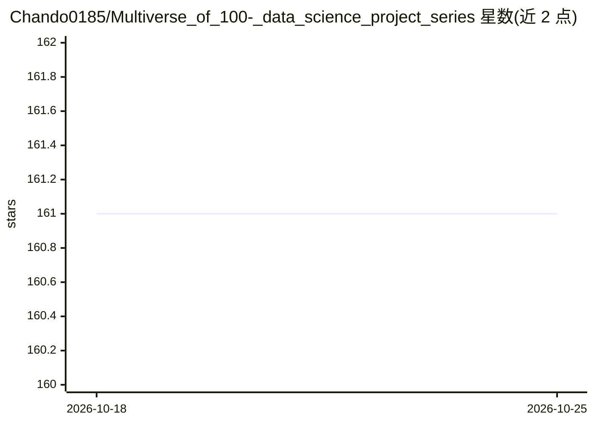

# Chando0185/Multiverse_of_100-_data_science_project_series

⭐ 161 · Jupyter Notebook · 推送 2026-07-12 · [GitHub](https://github.com/Chando0185/Multiverse_of_100-_data_science_project_series) · 个人维护

**数据科学实战项目清单：100+ 项目覆盖 ML/CV/NLP 等领域**

个人维护的数据科学项目集合目录：以表格形式列出 100+ 个实战项目，覆盖机器学习、深度学习、NLP、计算机视觉、推荐系统、RAG、AI Agent 等类别，每个条目含项目名称、类别标签与跳转链接；多数项目托管在独立 GitHub 仓库，并配套 YouTube 教程。仓库本身不含代码，主要作为学习路线导航与项目索引，支持社区 fork 与提交贡献。

## 筛选速览

| 维度 | 判定 | 备注 |
|---|---|---|
| AI 角色 | `ai-knowledge` | 知识聚合/清单类 |
| 许可风险 | `none` | — |
| 部署形态 | `None` |  |
| 模型依赖 | — | README 未给出锁定关系 |
| 硬件要求 | — | 无带数字的原话,不猜 |
| 安装摩擦 | `low` | 无编译、无系统依赖或容器化 |
| 成熟度 | — | 结构信号不足 |

## 能力要点

- 100+ 项目按 ML/CV/NLP/RAG/Agent 等类别编目
- 每个条目含类别标签与外链，项目多托管于独立仓库
- 配套 YouTube 分步教程，接受社区贡献

## 适用场景

- 按类别查找数据科学实战项目练手
- 跟随清单系统性学习 ML 到 LLM 应用开发
- 寻找毕业设计或作品集项目选题

## 场景标签

`教程课程` `精选清单` · 领域:学习与行业

## 证据(README 行号)

> L7: This repository is a growing collection of 100+ data science projects designed to help learners and professionals bu
> L22: |No.|Project Title|Category|Link|

## 星数曲线

2026-10-18 161 → 2026-10-25 161（+0）

---
*卡片 v1 · prompt 1.4 · 生成 2026-10-22 · 置信度 high · 依据 README sha `bee7081e6607` · [字段定义](../../DATASET.md)*
