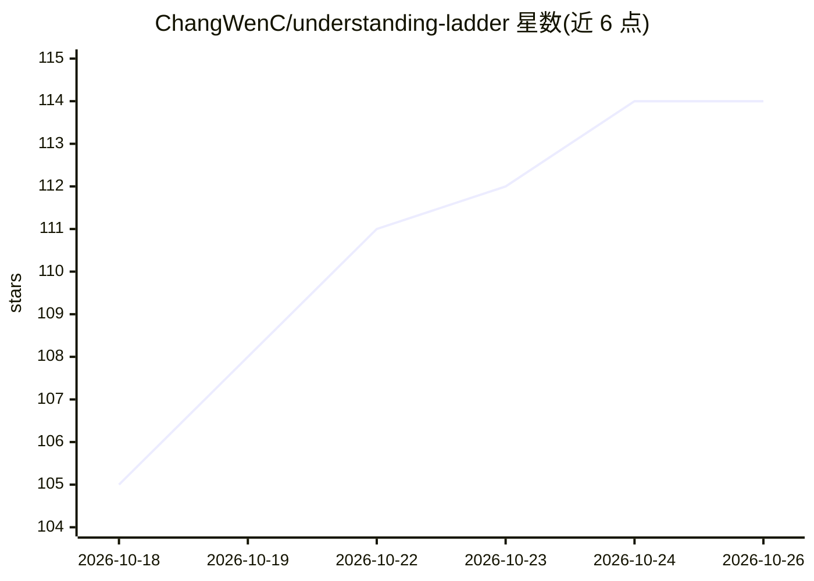

# ChangWenC/understanding-ladder

⭐ 114 · MIT · 推送 2026-10-06 · [GitHub](https://github.com/ChangWenC/understanding-ladder) · [官网](https://changwenc.github.io/understanding-ladder/docs/demo/) · 个人维护 · 中文 README

**按 Karpathy 理解阶梯自动选择格式的 agent 解释技能**

两个 Agent Skills（SKILL.md 格式）：understanding-ladder 对内容分类，选取能完整回答问题的最低阶梯（ASD-STE100 受控文本/Mermaid 图/带滑块的单文件交互 HTML/视频分镜脚本）并生成对应输出；plain-chinese 为中文输出定义 15 条简明规则。规则包括不删减任何事实、先出文本草稿、输出末尾附核对清单。通过 npx skills 安装到支持 Agent Skills 的工具（Claude Code、Codex、Cursor），或作为 Claude Code 插件安装；第 4 阶渲染依赖外部视频工具（showtime 0.4.0+ 可直接读取分镜表）。

## 筛选速览

| 维度 | 判定 | 备注 |
|---|---|---|
| AI 角色 | `ai-ecosystem` | LLM/agent 周边工具 |
| 许可风险 | `permissive` | MIT |
| 部署形态 | `library` | 以包/库形式分发 |
| 模型依赖 | — | README 未给出锁定关系 |
| 硬件要求 | — | 无带数字的原话,不猜 |
| 安装摩擦 | `low` | 无编译、无系统依赖或容器化 |
| 成熟度 | — | 结构信号不足 |

## 能力要点

- 按内容类型自动选取最低足够阶梯并生成对应格式输出
- 中文规则集 plain-chinese（15 条，词/句/段/删留分组）
- 每级输出保留全部数字、条件与限定语，并附 What to check 核对清单
- 零依赖；单文件交互 HTML 双击即开

## 适用场景

- 让 agent 用更易理解的格式解释技术内容
- 把密集的 LLM 输出改写为图/交互页而不丢信息
- 中文场景下获得简明中文的技术解释

## 场景标签

`AI 写作` `提示工程` · 领域:Agent 开发

## 证据(README 行号)

> L3: **Agent skills that make LLM explanations easier to understand — built on Karpathy's understanding ladder.**
> L69: **Any agent that supports Agent Skills** (Claude Code, Codex, Cursor, …), via skills:
> L72: npx skills add ChangWenC/understanding-ladder

## 星数曲线

2026-10-18 105 → 2026-10-26 114（+9）

---
*卡片 v1 · prompt 1.4 · 生成 2026-10-23 · 置信度 high · 依据 README sha `038b49feffb3` · [字段定义](../../DATASET.md)*
