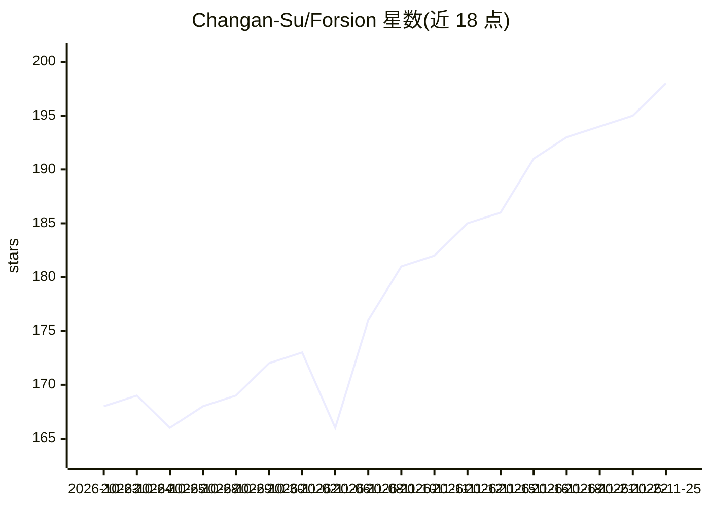

# Changan-Su/Forsion

⭐ 198 · TypeScript · Apache-2.0 · 推送 2026-11-24 · [GitHub](https://github.com/Changan-Su/Forsion) · [官网](https://forsion.net) · 个人维护 · 中文 README

**本地优先的第二大脑工作台，AI 代理与你的文件同桌协作**

基于本地 Markdown 文件的个人知识管理桌面应用：Notion 风格块编辑器、数据库、白板、PDF 批注和日历均落在本地磁盘。内置 Tangu 等 AI 代理，在授权范围内读取并修改你的文件（每轮列出改动文件、可撤销），Muse 代理按日程与规则主动准备内容并通过微信/Telegram/QQ 通知。支持多代理协作、记忆面板、20 多个官方插件商店，代理可沙箱内生成并试用新插件。提供桌面安装包、Web 版、Android APK，本地模型可通过 Ollama 接入。

## 筛选速览

| 维度 | 判定 | 备注 |
|---|---|---|
| AI 角色 | `ai-native` | 本体是模型或模型工具 |
| 许可风险 | `permissive` | Apache-2.0 |
| 部署形态 | `desktop` | 安装包/桌面程序 |
| 模型依赖 | local-ok | 支持本地模型 |
| 硬件要求 | — | 无带数字的原话,不猜 |
| 安装摩擦 | `low` | 无编译、无系统依赖或容器化 |
| 成熟度 | — | 结构信号不足 |

## 能力要点

- 块编辑器直接操作本地 .md 文件，支持 wikilinks、反链与图谱
- Tangu 代理读写本地文件并输出可交互卡片，每轮改动可逐文件撤销
- Muse 主动代理按规则监听日程，产出普通笔记与日历条目
- AGENT.md/HUMAN.md 双向文件约定与可见的记忆面板

## 适用场景

- 把笔记、PDF 和项目文件放在一个工作台统一管理
- 在聊天中让 AI 读取项目文件并生成可复用的计算卡片
- 让代理按日程规则主动准备材料并推送通知
- 在商店安装或让 AI 生成插件扩展功能

## 场景标签

`知识库管理` `AI 助手` · 领域:对话与助手

## 证据(README 行号)

> L11: **Forsion is a local-first second-brain workbench.** Your notes, files and projects sit on one desk on your own com
> L47: - **Any model.** Forsion-hosted models, your own API keys, OpenAI-compatible endpoints, local Ollama, or a supporte
> L107: Download the latest release from GitHub Releases, or open the web app in a browser.

## 星数曲线

2026-10-23 168 → 2026-11-25 198（+30）

---
*卡片 v1 · prompt 1.4 · 生成 2026-11-25 · 置信度 mid · 依据 README sha `cf19ebde3b7c` · [字段定义](../../DATASET.md)*
