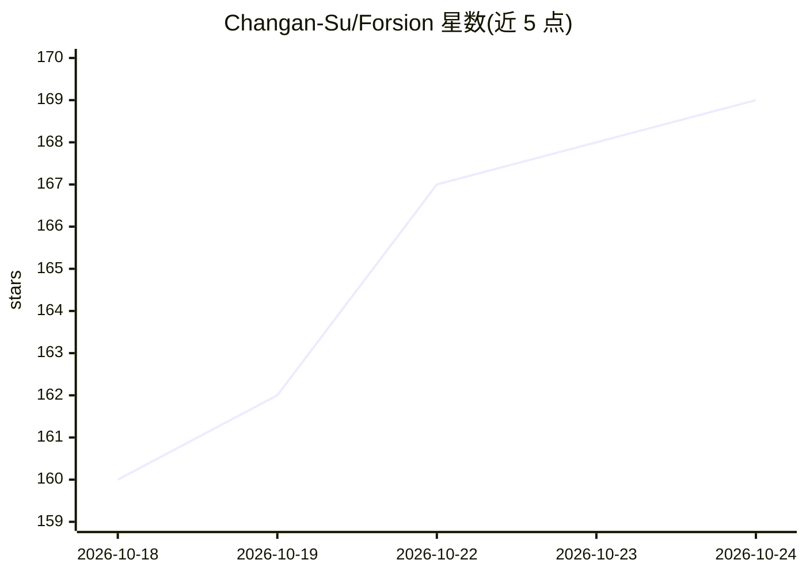

# Changan-Su/Forsion

⭐ 166 · TypeScript · NOASSERTION · 推送 2026-10-24 · [GitHub](https://github.com/Changan-Su/Forsion) · [官网](https://forsion.net) · 个人维护 · 中文 README

**本地优先的 AI 第二大脑桌面应用：笔记+Agent 团队协作**

面向个人用户的本地优先 AI 工作台：以本地 Markdown 文件为基础提供 Notion 风格块编辑器，支持 wikilinks、数据库、白板、PDF 标注；Agent 具备可查看编辑的长期记忆，可组建成持久 TEAM 并行工作；Muse 按心跳、日程与规则主动跟进任务并送回 Inbox。模型可选 Forsion 托管、自有 API、OpenAI 兼容端点、本地 Ollama 或订阅登录；可通过 ACP 接入 Claude Code、Codex 引擎。桌面端提供 macOS/Windows/Linux 安装包，另有 Web 与 Android 云端访问端。

## 筛选速览

| 维度 | 判定 | 备注 |
|---|---|---|
| AI 角色 | `ai-native` | 本体是模型或模型工具 |
| 许可风险 | `none` | NOASSERTION |
| 部署形态 | `desktop` | 安装包/桌面程序 |
| 模型依赖 | local-ok | 支持本地模型 |
| 硬件要求 | — | 无带数字的原话,不猜 |
| 安装摩擦 | `low` | 无编译、无系统依赖或容器化 |
| 成熟度 | — | 结构信号不足 |

## 能力要点

- 本地 Markdown 文件的 Notion 风格块编辑器（wikilinks/数据库/白板/PDF 标注）
- 可查看、编辑、遗忘的 Agent 长期记忆机制
- 持久 TEAM 并行协作与 Team Desk 进展视图，Muse 主动跟进任务到 Inbox
- 插件系统：技能、MCP 外部工具、Computer Use、扩展商店

## 适用场景

- 在本地文件上组织研究项目并与多个 Agent 协作推进
- 让 Agent 记住偏好与项目背景并在后续对话中使用
- 给持续工作安排定时跟进，结果回到 Inbox 处理
- 通过 WeChat/Telegram/QQ 渠道在其他平台访问 Agent

## 场景标签

`知识库管理` `多智能体` `AI 助手` · 领域:Agent 开发

## 证据(README 行号)

> L16: Forsion is a **local-first AI second brain**. Organize your own Markdown files in a Notion-style block editor, thin
> L132: - **Choose your models.** Use Forsion-hosted models, your own API connection, OpenAI-compatible endpoints, local O

## 星数曲线

2026-10-18 160 → 2026-10-24 169（+9）

---
*卡片 v1 · prompt 1.4 · 生成 2026-10-22 · 置信度 mid · 依据 README sha `49137cfe4ae8` · [字段定义](../../DATASET.md)*
