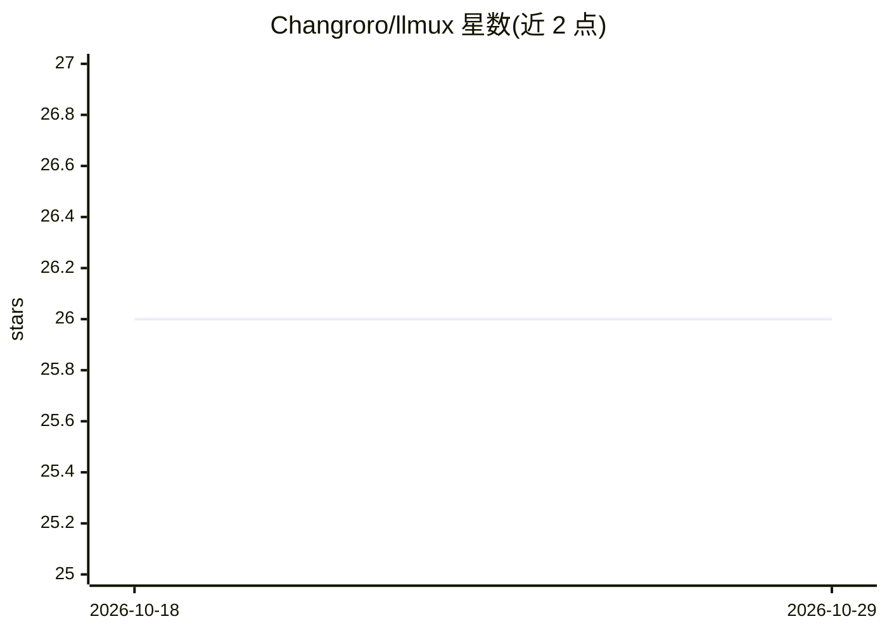

# Changroro/llmux

⭐ 26 · Python · MIT · 推送 2026-09-30 · [GitHub](https://github.com/Changroro/llmux) · [官网](https://changroro.github.io/llmux/) · 个人维护

**统一终端管理 vLLM 与 llama.cpp 推理服务器的 TUI+CLI 工具**

面向在 Linux + NVIDIA GPU 上自托管 LLM 的开发者：用单个 Textual TUI 和无头 CLI 管理 vLLM 与 llama.cpp 两套引擎的容器生命周期，底层基于 Docker Compose 运行官方镜像。核心机制包括：单一 profiles.yaml 配置、启动前端口/GPU 冲突检查、实时 tok/s 与 KV 缓存监控（读取引擎 Prometheus 指标）、VRAM 感知的 vLLM recipe 导入、hf-mem 显存估算、量化基准测试。不代理推理请求，也不提供聊天 UI。要求 Docker Engine 与 NVIDIA Container Toolkit，暂不支持 macOS/ROCm/CPU-only。

## 筛选速览

| 维度 | 判定 | 备注 |
|---|---|---|
| AI 角色 | `ai-ecosystem` | LLM/agent 周边工具 |
| 许可风险 | `permissive` | MIT |
| 部署形态 | `self-host` | docker 或自建部署 |
| 模型依赖 | local-ok | 支持本地模型 |
| 硬件要求 | `cpu-ok` | |
| 安装摩擦 | `low` | 无编译、无系统依赖或容器化 |
| 成熟度 | — | 结构信号不足 |

## 能力要点

- 单一 Textual 仪表盘统一管理 vLLM 与 llama.cpp 配置文件
- 实时 tok/s、KV 缓存、缓存命中率与延迟百分位监控（读 Prometheus 指标）
- 启动前跨后端端口/GPU 冲突检查，拒绝 :latest 镜像并在容器内校验版本
- VRAM 感知 recipe 导入与 hf-mem 每 GPU 显存适配条

## 适用场景

- 同时实验多个模型，用命名配置文件快速启停不同引擎
- 在下载/启动前评估模型是否装得进我的 GPU 显存
- 在同一硬件上对比不同量化方案的性能
- 无终端界面环境下用 CLI 脚本化启动与查询模型状态

## 场景标签

`推理引擎` · 领域:训练与推理

## 证据(README 行号)

> L5: **Run and manage vLLM and llama.cpp servers from one terminal — TUI or CLI.**
> L21: llmux unifies both under a single Textual dashboard backed by Docker Compose.
> L143: **What llmux is not.** It doesn't proxy or route inference requests — each profile serves on its own port, and llm

## 星数曲线

2026-10-18 26 → 2026-10-29 26（+0）

---
*卡片 v1 · prompt 1.4 · 生成 2026-10-26 · 置信度 mid · 依据 README sha `f8b7b95c0eeb` · [字段定义](../../DATASET.md)*
