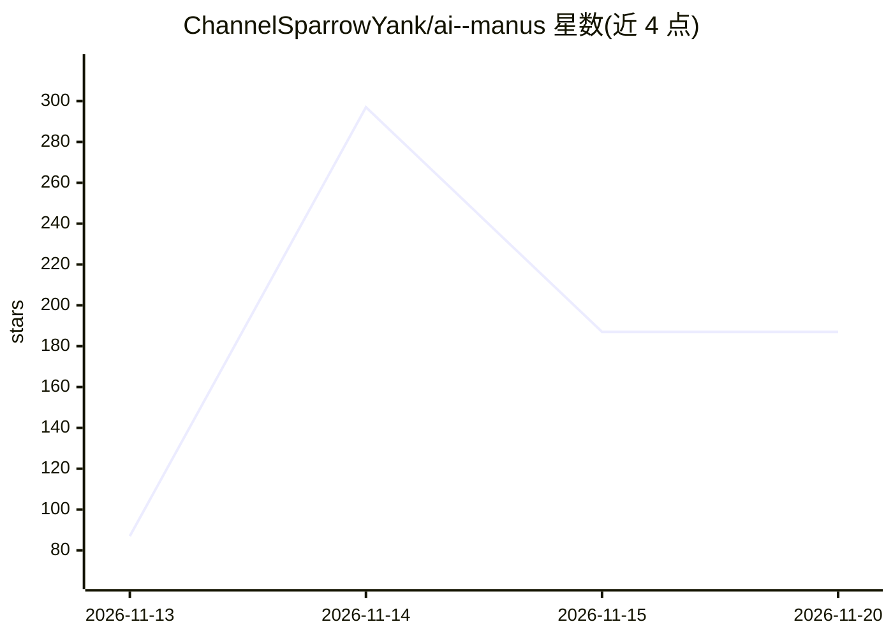

# ChannelSparrowYank/ai--manus

⭐ 187 · Apache-2.0 · 推送 2026-11-15 · [GitHub](https://github.com/ChannelSparrowYank/ai--manus) · 个人维护

**面向日常小任务的自主 AI Agent：自动执行代码与控制浏览器**

README 描述的自主 AI 代理，声明可代用户编写并执行脚本、控制浏览器（导航网页、填写表单、采集信息），并以个人助手形式在后台执行多步任务，面向学生、远程办公者等非开发者用户的小型场景。README 列出了 4GB 内存等兼容性要求，但未提供任何安装命令、代码仓库结构或技术实现细节，整体为功能描述文本，内容可验证性有限。

## 筛选速览

| 维度 | 判定 | 备注 |
|---|---|---|
| AI 角色 | `ai-native` | 本体是模型或模型工具 |
| 许可风险 | `permissive` | Apache-2.0 |
| 部署形态 | `None` |  |
| 模型依赖 | — | README 未给出锁定关系 |
| 硬件要求 | — | 无带数字的原话,不猜 |
| 安装摩擦 | `low` | 无编译、无系统依赖或容器化 |
| 成熟度 | — | 结构信号不足 |

## 能力要点

- 声明支持自主代码执行（写脚本并运行）
- 声明支持浏览器控制（导航、填表、采集信息）
- 声明支持跨会话的任务模式记忆与多步任务
- 声明代码与浏览器操作可在同一流程中衔接

## 适用场景

- 让代理代替自己完成重复性的网页操作与表单填写
- 整理研究资料、运行小脚本等学习场景
- 远程办公时从多个页面收集信息并汇总

## 场景标签

`AI 助手` `浏览器自动化` `编码 Agent` · 领域:效率与自动化

## 证据(README 行号)

> L10: - **Autonomous Code Execution:** Manus AI agent runs code on its own to complete tasks, so you can focus on decisio
> L18: Manus is an autonomous AI agent designed to run code and control a browser on your behalf. Instead of acting like a
> L22: Manus is not a heavy studio suite or a complex enterprise platform. It is a focused helper built for home, study, a

## 星数曲线

2026-11-13 87 → 2026-11-20 187（+100）

---
*卡片 v1 · prompt 1.4 · 生成 2026-11-17 · 置信度 mid · 依据 README sha `0f78ee3a5dd2` · [字段定义](../../DATASET.md)*
