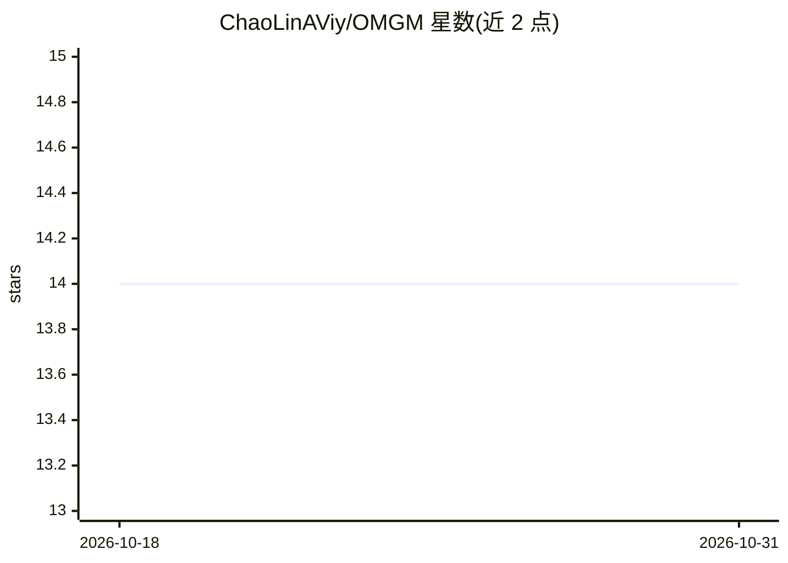

# ChaoLinAViy/OMGM

⭐ 14 · Python · 推送 2025-12-30 · [GitHub](https://github.com/ChaoLinAViy/OMGM) · [官网](https://arxiv.org/abs/2505.07879) · 组织维护

**ACL 2025 论文 OMGM 官方实现：多粒度多模态知识检索问答系统**

论文官方代码库，实现多粒度多模态检索流程：Step1 用 FAISS 索引与视觉模型（示例为 eva-clip）做粗粒度跨模态实体检索；Step2 训练并使用多模态融合重排器（默认 qformer_IT2IT_reranker）做混合粒度重排；Step3 用 LLM/MLLM（可选 llama3/mistral/llava1_5/internvl2_5）做细粒度章节增强生成回答。提供 E-VQA 与 InfoSeek 数据、知识库、FAISS 索引、重排器与微调 LLaVA-1.5-7B 权重下载链接。面向研究者复现实验，需 conda 环境自建并下载多源图像数据，数据准备流程较长。

## 筛选速览

| 维度 | 判定 | 备注 |
|---|---|---|
| AI 角色 | `ai-native` | 本体是模型或模型工具 |
| 许可风险 | `none` | — |
| 部署形态 | `library` | 以包/库形式分发 |
| 模型依赖 | — | README 未给出锁定关系 |
| 硬件要求 | — | 无带数字的原话,不猜 |
| 安装摩擦 | `low` | 无编译、无系统依赖或容器化 |
| 成熟度 | — | 结构信号不足 |

## 能力要点

- 三阶段流程：粗粒度实体检索→多模态融合重排→章节增强生成
- 提供预训练重排器权重与微调 LLaVA-1.5-7B 生成器权重
- 提供 E-VQA/InfoSeek 数据、知识库与 FAISS 索引下载链接
- 生成器可选 llama3/mistral/llava1_5/internvl2_5

## 适用场景

- 复现 ACL 2025 OMGM 论文的检索问答实验
- 在百科类 VQA 数据集上评估多模态检索效果
- 基于该流程做多粒度多模态 RAG 的研究改进

## 场景标签

`RAG` `多模态` · 领域:知识与检索

## 证据(README 行号)

> L3: This is the official implementation of OMGM: Orchestrate Multiple Granularities and Modalities for Efficient Multimo
> L195: By running the following command, we can perform top-1 section selection within the top-1 entity using the text si
> L210: --`answer_generator`: Name of the answer generator model to be used. Choose from [llama3, mistral, llava1_5, inter

## 星数曲线

2026-10-18 14 → 2026-10-31 14（+0）

---
*卡片 v1 · prompt 1.4 · 生成 2026-10-31 · 置信度 high · 依据 README sha `fbf06053e75b` · [字段定义](../../DATASET.md)*
