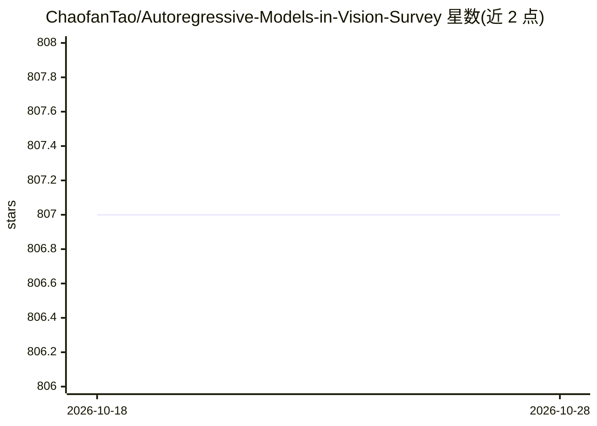

# ChaofanTao/Autoregressive-Models-in-Vision-Survey

⭐ 807 · 推送 2026-05-05 · [GitHub](https://github.com/ChaofanTao/Autoregressive-Models-in-Vision-Survey) · [官网](https://arxiv.org/abs/2411.05902) · 组织维护 · 中文 README

**视觉自回归模型论文策展清单（TMLR 2025 综述配套）**

TMLR 2025 综述论文《Autoregressive Models in Vision: A Survey》的配套论文清单仓库，由港大、清华、杜克等多所高校及企业研究者合作维护。按图像生成、视频生成、多模态等类别组织自回归视觉生成方向的论文条目，每条含会议/年份与论文、代码链接，覆盖 pixel-wise/token-wise 生成、tokenizer、自回归建模等细分方向。2025-11-01 起进入维护模式，暂停主动更新，接受定向 PR。提供中文解读文章链接。

## 筛选速览

| 维度 | 判定 | 备注 |
|---|---|---|
| AI 角色 | `ai-knowledge` | 知识聚合/清单类 |
| 许可风险 | `none` | — |
| 部署形态 | `None` |  |
| 模型依赖 | — | README 未给出锁定关系 |
| 硬件要求 | — | 无带数字的原话,不猜 |
| 安装摩擦 | `low` | 无编译、无系统依赖或容器化 |
| 成熟度 | — | 结构信号不足 |

## 能力要点

- TMLR 2025 综述论文的配套策展清单
- 按图像/视频生成等类别组织论文条目，附论文与代码链接
- 覆盖 pixel-wise/token-wise 生成、tokenizer、自回归建模等细分方向
- 提供中文解读文章

## 适用场景

- 查阅视觉自回归生成方向的论文与代码
- 按类别跟踪图像生成、tokenizer 等研究脉络
- 为该方向综述写作收集文献线索

## 场景标签

`精选清单` · 领域:学习与行业

## 证据(README 行号)

> L9: Autoregressive models have shown significant progress in generating high-quality content by modeling the dependencie
> L11: > **Paper**: [[TMLR 2025🔥]](https://openreview.net/forum?id=1BqXkjNEGP) Autoregressive Models in Vision: A Survey |

## 星数曲线

2026-10-18 807 → 2026-10-28 807（+0）

---
*卡片 v1 · prompt 1.4 · 生成 2026-10-21 · 置信度 high · 依据 README sha `af7c09784cc1` · [字段定义](../../DATASET.md)*
