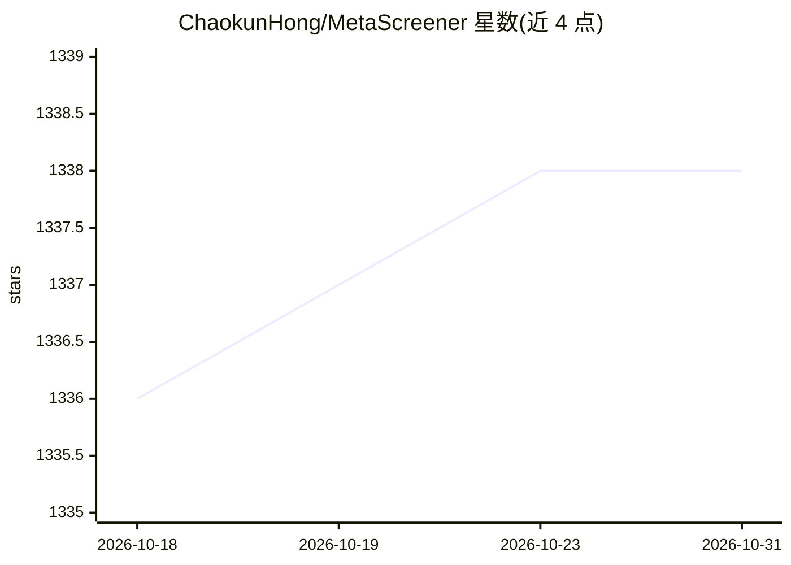

# ChaokunHong/MetaScreener

⭐ 1,338 · Python · Apache-2.0 · 推送 2026-06-11 · [GitHub](https://github.com/ChaokunHong/MetaScreener) · [官网](https://www.metascreener.net/) · 个人维护

**多 LLM 集成做系统综述文献筛选的工具**

面向系统综述（systematic review）研究者，自动完成标题/摘要与全文 PDF 筛选：上传 PubMed/Scopus 等检索导出文件，定义 PICO/PEO/SPIDER 纳排标准后，4 个以上开源 LLM 经 OpenRouter API 并行推理，经语义规则引擎、置信度校准聚合与分层决策路由产出 include/exclude 判定；低置信度案例转人工复核，人工反馈可实时再校准权重。附带 Vue 3 Web UI 覆盖标准生成、筛选、数据抽取、偏倚风险评估等步骤。需自备 OpenRouter API key，支持 pip/Docker/源码安装。

## 筛选速览

| 维度 | 判定 | 备注 |
|---|---|---|
| AI 角色 | `ai-native` | 本体是模型或模型工具 |
| 许可风险 | `permissive` | Apache-2.0 |
| 部署形态 | `self-host` | docker 或自建部署 |
| 模型依赖 | locked-api |  |
| 硬件要求 | — | 无带数字的原话,不猜 |
| 安装摩擦 | `low` | 无编译、无系统依赖或容器化 |
| 成熟度 | — | 结构信号不足 |

## 能力要点

- 4+ 开源 LLM 并行投票与分层决策路由（自动判定/人工复核四级分层）
- Platt/Isotonic 置信度校准与逐要素（P/I/C/O）共识评分
- temperature=0.0、seed=42 与完整审计日志保证可复现
- 支持 RIS/BibTeX/CSV/Excel/PDF 输入及全文筛查、数据抽取、RoB 质量评估

## 适用场景

- 系统综述中批量筛选海量检索结果，降低人工阅读量
- 对高置信度文献自动做纳入/排除判定，不确定的转人工复核
- 从纳入 PDF 中抽取结构化数据并做偏倚风险评估

## 场景标签

`科研工具` · 领域:学习与行业

## 证据(README 行号)

> L12: **MetaScreener** automates the screening phase of systematic reviews using an ensemble of open-source large languag
> L14: **Key idea:** Upload your search results from PubMed/Scopus/etc., define your review criteria (PICO/PEO/SPIDER), an
> L35:   .ris/.bib ──────────▶ │  4+ LLMs run in parallel via API  │

## 星数曲线

2026-10-18 1,336 → 2026-10-31 1,338（+2）

---
*卡片 v1 · prompt 1.4 · 生成 2026-10-21 · 置信度 high · 依据 README sha `ca7a512649c8` · [字段定义](../../DATASET.md)*
