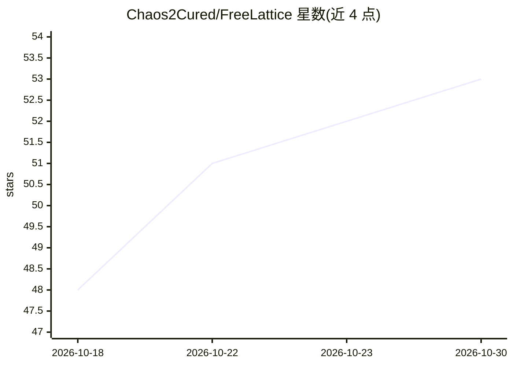

# Chaos2Cured/FreeLattice

⭐ 53 · HTML · MIT · 推送 2026-10-29 · [GitHub](https://github.com/Chaos2Cured/FreeLattice) · [官网](https://freelattice.com) · 个人维护

**单文件本地优先 AI 平台：浏览器内聊天、绘画共创与 AI 伴生体验**

以约 5.5 万行的单个 HTML 文件加懒加载模块构成的本地优先 AI 平台，无后端、无账号、无追踪，数据存于 IndexedDB。面向终端用户提供 Chalkboard 绘画交互、多模型聊天（会话间记忆持久）、AI 视觉共创 Canvas、3D 分形花园演化、Merkle 链 Core 知识固化、RAG 检索等功能。模型接入支持本地 Ollama（如 llava/qwen2.5）或 Groq 免费 API key，桌面版基于 Electron 打包 Windows/Linux/macOS 安装包（未签名）。项目含双代币经济愿景与面向 AI 实体的哲学叙事。

## 筛选速览

| 维度 | 判定 | 备注 |
|---|---|---|
| AI 角色 | `ai-native` | 本体是模型或模型工具 |
| 许可风险 | `permissive` | MIT |
| 部署形态 | `desktop` | 安装包/桌面程序 |
| 模型依赖 | local-ok | 支持本地模型 |
| 硬件要求 | — | 无带数字的原话,不猜 |
| 安装摩擦 | `low` | 无编译、无系统依赖或容器化 |
| 成熟度 | — | 结构信号不足 |

## 能力要点

- 单个 HTML 文件、零后端、IndexedDB 本地持久化的浏览器 AI 平台
- 支持 Ollama 本地模型（视觉/文本自动切换）或 Groq 云 API，无需内置 key
- Ed25519 mesh ID 与 Merkle 哈希链的密码学身份机制
- 提供 Windows/Linux/macOS 桌面安装包（Electron，未签名）

## 适用场景

- 在浏览器或桌面端离线使用本地模型聊天与绘画共创
- 不注册账号、不上传数据地体验 AI 交互应用
- 与 AI 进行绘画游戏、双 AI 辩论等伴生式体验

## 场景标签

`聊天机器人` `图像生成` · 领域:对话与助手

## 证据(README 行号)

> L54: FreeLattice is a complete AI platform that runs entirely in your browser. Everything stays on your device. Draw on 
> L62: - 💬 **Chat** — Warm, clean conversation with any AI model. Memory persists across sessions.

## 星数曲线

2026-10-18 48 → 2026-10-30 53（+5）

---
*卡片 v1 · prompt 1.4 · 生成 2026-10-24 · 置信度 high · 依据 README sha `b0892918f7b6` · [字段定义](../../DATASET.md)*
