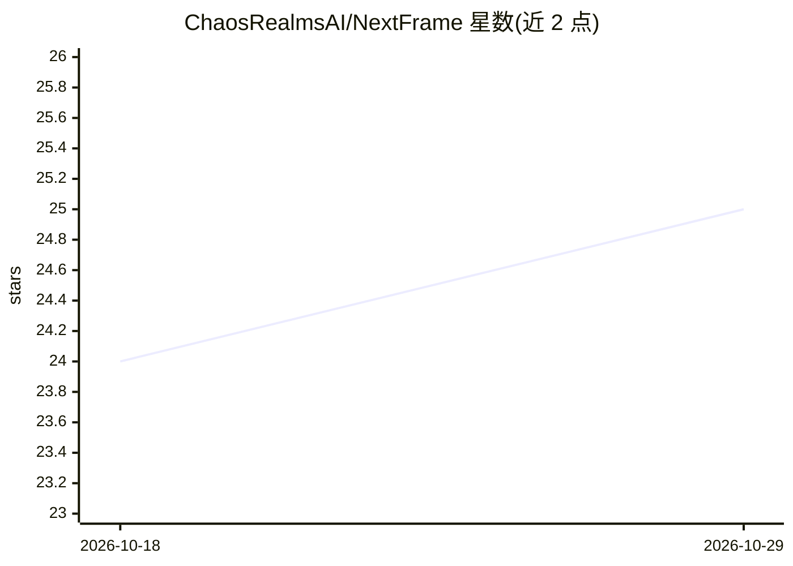

# ChaosRealmsAI/NextFrame

⭐ 25 · Rust · MIT · 推送 2026-04-26 · [GitHub](https://github.com/ChaosRealmsAI/NextFrame) · 组织维护

**给 AI/开发者的视频编辑器与运行时：JSON 合成渲染成 MP4**

Rust 编写的 AI-native 视频编辑器与运行时：结构化 JSON 组合（composition）经 AI 校验后，可在 macOS 桌面编辑器中打开、实时编辑、带音频/字幕预览，并导出为 MP4。核心模块包括面向 AI 的命令行入口 nf-cli（JSON 输出、组合校验）、桌面壳 nf-shell（WebView/IPC）、项目模型 nf-project、以及负责 HTML/运行时捕获与 MP4 导出的 nf-recorder。通过 cargo 构建，编辑器 UI 用零框架 Web Components 实现；桌面壳为 macOS 平台。

## 筛选速览

| 维度 | 判定 | 备注 |
|---|---|---|
| AI 角色 | `ai-ecosystem` | LLM/agent 周边工具 |
| 许可风险 | `permissive` | MIT |
| 部署形态 | `None` |  |
| 模型依赖 | — | README 未给出锁定关系 |
| 硬件要求 | — | 无带数字的原话,不猜 |
| 安装摩擦 | `low` | 无编译、无系统依赖或容器化 |
| 成熟度 | — | 结构信号不足 |

## 能力要点

- JSON composition → AI verify → 桌面编辑 → 导出 MP4 的产品闭环
- nf-cli 提供面向 AI 的命令入口与 JSON 输出、组合校验
- macOS 桌面编辑器支持实时编辑与音频/字幕预览
- HTML/运行时捕获并导出 MP4（nf-recorder + WebKit/CoreAnimation 层）

## 适用场景

- AI agent 或程序通过结构化数据生成视频
- 在桌面编辑器中实时编辑并预览带音频/字幕的视频项目
- 校验并导出 JSON 组合为 MP4 成片

## 场景标签

`视频生成` · 领域:内容生成

## 证据(README 行号)

> L3: NextFrame is an AI-native video editor and runtime. Structured JSON compositions render in a desktop editor, can be 
> L8: JSON composition -> AI verify -> desktop editor -> live edit -> saved source -> MP4 export
> L49: - `nf-cli`: AI-facing command entry, JSON output, composition verification, editor/export verification commands.

## 星数曲线

2026-10-18 24 → 2026-10-29 25（+1）

---
*卡片 v1 · prompt 1.4 · 生成 2026-10-27 · 置信度 mid · 依据 README sha `774a9262b73a` · [字段定义](../../DATASET.md)*
