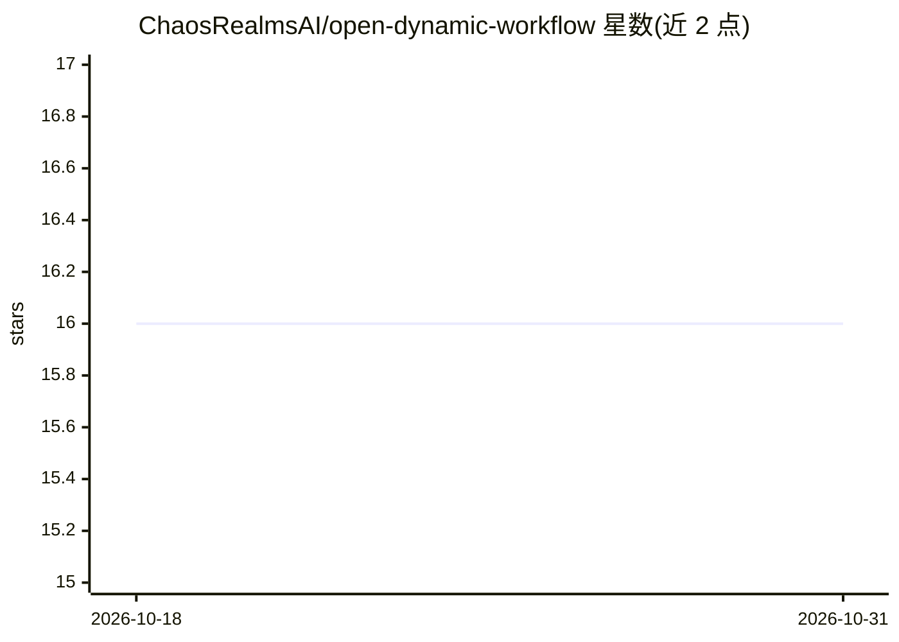

# ChaosRealmsAI/open-dynamic-workflow

⭐ 16 · Rust · MIT · 推送 2026-06-10 · [GitHub](https://github.com/ChaosRealmsAI/open-dynamic-workflow) · 组织维护 · 中文 README

**开源复刻 Claude Code Dynamic Workflow 的 JS 工作流编排运行时**

Rust 编写的双 crate 工具：odw 负责编排，运行 agent()/parallel()/pipeline() 等 JavaScript 工作流图，提供确定性恢复、git-worktree 隔离、token 预算与离线 HTML 执行图报告，自身不调用模型；pandacode 作为子进程执行器，将单个编码任务经 codex、claude 或国产模型（deepseek/kimi/qwen 等）运行并返回结构化报告。面向需要自托管、可换执行器、异构廉价模型的 agent 工作流开发者。通过 git clone + install.sh 或 cargo 构建安装。

## 筛选速览

| 维度 | 判定 | 备注 |
|---|---|---|
| AI 角色 | `ai-ecosystem` | LLM/agent 周边工具 |
| 许可风险 | `permissive` | MIT |
| 部署形态 | `None` |  |
| 模型依赖 | locked-api |  |
| 硬件要求 | — | 无带数字的原话,不猜 |
| 安装摩擦 | `medium` | 含编译或系统依赖之一 |
| 成熟度 | — | 结构信号不足 |

## 能力要点

- 编排与执行解耦：odw 调度，pandacode 执行，可独立替换
- 确定性恢复（journal）与 git-worktree 并行隔离
- 每次运行生成离线 Mermaid 执行图，展示节点模型/token/耗时
- pandacode 支持 codex、claude 及 bamboo 国产模型执行器

## 适用场景

- 自托管运行 agent 编写的多节点并行工作流
- 用国产模型替换 Claude 子代理以降低 token 开销
- 并行文件编辑任务中避免 agent 冲突并支持断点恢复

## 场景标签

`工作流自动化` `编码 Agent` `Agent 框架` · 领域:Agent 开发

## 证据(README 行号)

> L7: **Open Dynamic Workflow (`odw`) is an open re-implementation of Claude Code's
> L19: |`odw/`|`odw`|**Orchestration.** Runs the workflow graph — `agent()`, `parallel()`, `pipeline()`, phases, budgets, 
> L34: - **Bring your own executor.** `odw` only schedules. `pandacode` is the default

## 星数曲线

2026-10-18 16 → 2026-10-31 16（+0）

---
*卡片 v1 · prompt 1.4 · 生成 2026-10-30 · 置信度 high · 依据 README sha `abb4cccfaeca` · [字段定义](../../DATASET.md)*
