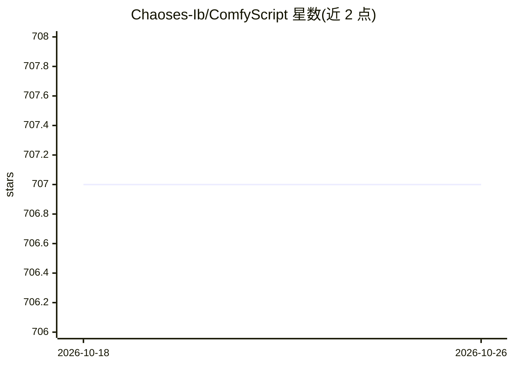

# Chaoses-Ib/ComfyScript

⭐ 707 · Python · MIT · 推送 2026-07-18 · [GitHub](https://github.com/Chaoses-Ib/ComfyScript) · [官网](https://discord.gg/arqJbtEg7w) · 个人维护

**ComfyUI 的 Python 前端与库：以脚本编写、运行与转换工作流**

面向 ComfyUI 用户的 Python 前端与库：提供工作流的人类可读脚本格式，transpiler 可将 ComfyUI 工作流自动翻译为脚本并作为图像元数据保存；runtime 支持本地或远程 ComfyUI 服务器执行脚本生成图像，可将节点当函数用于 ML 研究、调试自定义节点与优化缓存；还能用循环等脚本逻辑生成大型工作流，或转换为 web UI/API 格式。提供 pip 安装、自定义节点安装与 uv venv 等多种安装方式，附带 ipywidgets/Solara 组件。

## 筛选速览

| 维度 | 判定 | 备注 |
|---|---|---|
| AI 角色 | `ai-ecosystem` | LLM/agent 周边工具 |
| 许可风险 | `permissive` | MIT |
| 部署形态 | `library` | 以包/库形式分发 |
| 模型依赖 | — | README 未给出锁定关系 |
| 硬件要求 | — | 无带数字的原话,不猜 |
| 安装摩擦 | `low` | 无编译、无系统依赖或容器化 |
| 成熟度 | — | 结构信号不足 |

## 能力要点

- transpiler 将 ComfyUI 工作流自动翻译为 Python 脚本并存入图像元数据
- runtime 支持本地/远程执行，节点可作为函数复用并自动生成类型存根与枚举
- 异步队列执行，可中断当前任务、清空队列
- 提供 ipywidgets 与 Solara UI 组件（ImageViewer、MetadataViewer）

## 适用场景

- 用 Python 代码替代图形界面编写和运行 ComfyUI 工作流
- 在 ML 研究或其他项目中把 ComfyUI 节点当函数库复用
- 用循环批量生成大型工作流或转换 web UI/API 格式

## 场景标签

`图像生成` · 领域:内容生成

## 证据(README 行号)

> L4: A Python frontend and library for ComfyUI.
> L21: - Using ComfyUI as a function library.
> L23:  With ComfyScript, ComfyUI's nodes can be used as functions to do ML research, reuse nodes in other projects, debug

## 星数曲线

2026-10-18 707 → 2026-10-26 707（+0）

---
*卡片 v1 · prompt 1.4 · 生成 2026-10-21 · 置信度 high · 依据 README sha `6aeff519fe92` · [字段定义](../../DATASET.md)*
