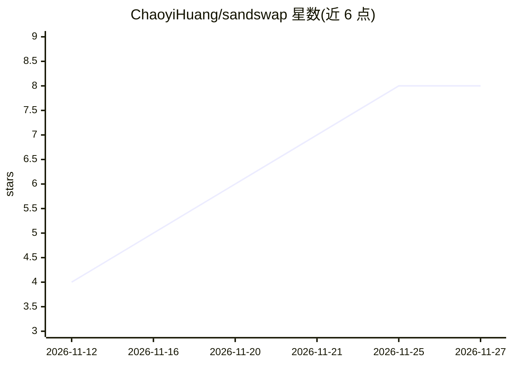

# ChaoyiHuang/sandswap

⭐ 8 · Go · NOASSERTION · 推送 2026-11-26 · [GitHub](https://github.com/ChaoyiHuang/sandswap) · [官网](https://chaoyihuang.github.io/sandswap/) · 个人维护 · 中文 README

**为 AI agent 提供毫秒级复用的 KVM microVM 沙箱**

基于 Linux KVM 的计算与磁盘解耦 tinyVM 沙箱运行时：自定义精简 guest kernel 无内置 rootfs，agent 的 SandFS 目录经 virtio-fs 按需挂载，空闲后异步换出并清理状态，官方基准为单个 tinyVM 每秒可复用 183 次。Agent 经 HTTPS（POST /agent/execute 等接口）或 MCP（12 个工具）调用，无需 SDK 与代码改动。要求宿主机 Linux 内核 ≥5.10 与 /dev/kvm、/dev/vhost-vsock。许可证为 BSL 1.1，2028-11-30 起转为 Apache-2.0。

## 筛选速览

| 维度 | 判定 | 备注 |
|---|---|---|
| AI 角色 | `ai-ecosystem` | LLM/agent 周边工具 |
| 许可风险 | `none` | NOASSERTION |
| 部署形态 | `None` |  |
| 模型依赖 | — | README 未给出锁定关系 |
| 硬件要求 | — | 无带数字的原话,不猜 |
| 安装摩擦 | `medium` | 含编译或系统依赖之一 |
| 成熟度 | — | 结构信号不足 |

## 能力要点

- 计算-磁盘解耦 tinyVM：无 rootfs，SandFS 按需挂载/异步换出
- HTTPS 与 MCP 两种调用面语义一致，agent 无需 SDK 与代码改动
- 4 层隔离：加固 guest kernel、PID 1 warden、sandvmm、宿主防御
- 官方基准：~2.3 ms 冷启动、~0.96 ms 热启动、单 tinyVM 每秒复用 183 次

## 适用场景

- 为执行 shell 命令和文件操作的 AI agent 提供隔离沙箱环境
- 多个 agent 共享轮转同一 tinyVM 以降低沙箱运行成本
- 在 bare-metal KVM 或嵌套虚拟化环境部署单机/分布式沙箱服务

## 场景标签

`Agent 框架` · 领域:Agent 开发

## 证据(README 行号)

> L16: A compute-and-disk decoupled tinyVM architecture built from scratch
> L38: Agents run commands over two surfaces with identical semantics — HTTPS
> L71: MCP (`POST /mcp`, 12 tools) ·

## 星数曲线

2026-11-12 4 → 2026-11-27 8（+4）

---
*卡片 v1 · prompt 1.4 · 生成 2026-11-20 · 置信度 high · 依据 README sha `db55cda2bd30` · [字段定义](../../DATASET.md)*
