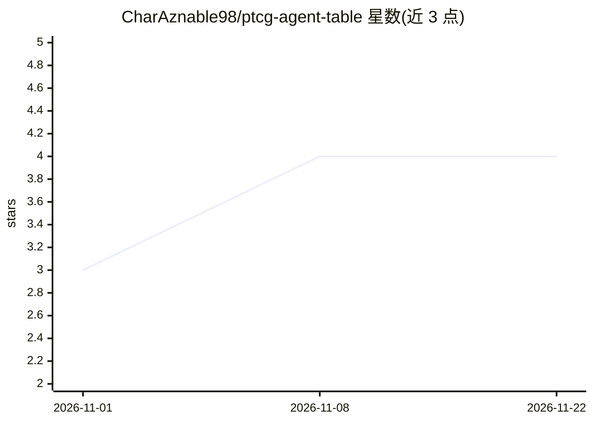

# CharAznable98/ptcg-agent-table

⭐ 4 · TypeScript · MIT · 推送 2026-11-14 · [GitHub](https://github.com/CharAznable98/ptcg-agent-table) · 个人维护 · 中文 README

**本地运行的 PTCG AI 对战牌桌：人机对战与策略复盘**

导入卡组后可与 AI 对手对战或观战两名 AI 互打；牌桌负责移动、洗牌、投币、状态标记，规则与卡牌效果由玩家或 AI 判断。AI 对手保存策略历史，普通对局结束后经赛后总结更新策略，并可运行策略版本对照评估。对局记录支持逐步回放与导出。以 Node.js 服务形式在本机运行，模型连接支持复用本地 ChatGPT/Codex 登录凭证或 OpenAI 兼容接口，数据全部保存在本机。

## 筛选速览

| 维度 | 判定 | 备注 |
|---|---|---|
| AI 角色 | `ai-native` | 本体是模型或模型工具 |
| 许可风险 | `permissive` | MIT |
| 部署形态 | `None` |  |
| 模型依赖 | — | README 未给出锁定关系 |
| 硬件要求 | — | 无带数字的原话,不猜 |
| 安装摩擦 | `low` | 无编译、无系统依赖或容器化 |
| 成熟度 | — | 结构信号不足 |

## 能力要点

- 人机对战与 AI 对战两种模式，支持逐步回放与记录导出
- AI 对手保存策略历史，通过赛后总结迭代策略
- 策略版本对照评估：复用相同开局、固定对手策略与模型配置
- 支持复用本地 ChatGPT/Codex 凭证或 OpenAI 兼容接口（Responses/Chat Completions）

## 适用场景

- 导入自己的卡组与 AI 对手练习对战
- 让两个 AI 对战并观战复盘
- 对照同一 AI 对手不同策略版本的表现
- 本地保存并管理卡组、策略与对局记录

## 场景标签

 · 领域:游戏/AI 对战

## 证据(README 行号)

> L3: 本地运行的 PTCG AI 对战牌桌。导入自己的卡组后，可以与 AI 对战，或观看两个 AI 对战。AI 对手保留策略版本，并通过赛后复盘积累经验；对局支持逐步回放和记录导出。
> L27: 3. 在「资料库 → AI 对手」点击「创建 AI 对手」，填写名称并绑定卡组。初始策略可留空，系统生成策略后保存 AI 对手。
> L76: 模型与思考强度通过下拉框选择，点击「刷新模型」同步接口提供的档位和默认值。选择「接口默认」时由提供方决定强度；接口未提供档位时，页面保留当前配置并提示未确认。初始配置为 `gpt-6.1-terra`、`medium`，不开启 f

## 星数曲线

2026-11-01 3 → 2026-11-22 4（+1）

---
*卡片 v1 · prompt 1.4 · 生成 2026-11-21 · 置信度 high · 依据 README sha `d32bfbf559b8` · [字段定义](../../DATASET.md)*
