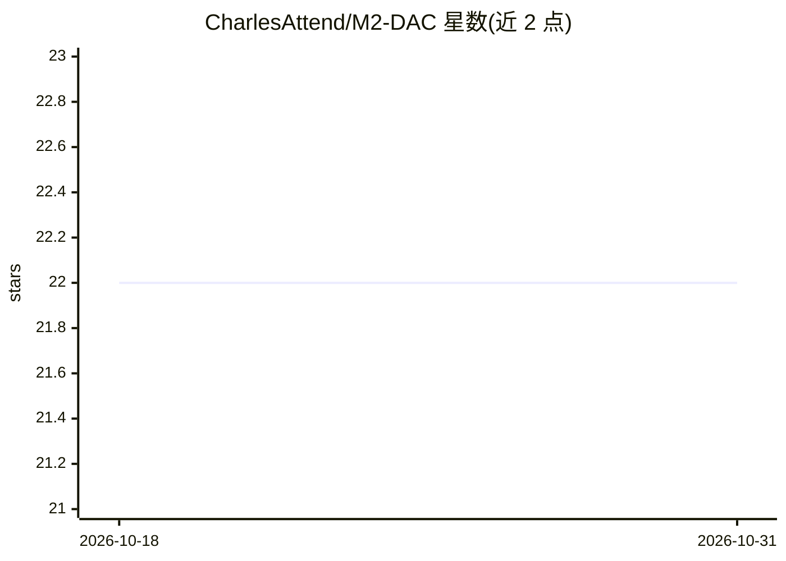

# CharlesAttend/M2-DAC

⭐ 22 · Jupyter Notebook · 推送 2026-06-12 · [GitHub](https://github.com/CharlesAttend/M2-DAC) · 个人维护

**索邦大学 M2 DAC/MIND 课程资料与学生贡献合集**

索邦大学（Sorbonne Université）数据科学与人工智能方向 Master DAC / MIND 的 M2 年级课程资源仓库。README 列出所修课程：深度学习（DEEPL/AMAL）、图像识别与解释（RDFIA）、数据科学研究方法（MEDS/REDS）、可解释人工智能（XAI）等。仓库以学生共建方式维护，号召通过 fork、添加文件、提交 merge request 的方式补充历年考试真题与新课程讲义，供后续届学生使用。内容为课程讲义与真题汇编，不提供软件安装或运行方式。

## 筛选速览

| 维度 | 判定 | 备注 |
|---|---|---|
| AI 角色 | `ai-knowledge` | 知识聚合/清单类 |
| 许可风险 | `none` | — |
| 部署形态 | `None` |  |
| 模型依赖 | — | README 未给出锁定关系 |
| 硬件要求 | — | 无带数字的原话,不猜 |
| 安装摩擦 | `low` | 无编译、无系统依赖或容器化 |
| 成熟度 | — | 结构信号不足 |

## 能力要点

- 收录 M2 DAC / MIND 多门 AI 与数据科学课程资料
- 课程覆盖深度学习、图像识别、XAI、统计学习等方向
- 鼓励学生通过 merge request 贡献考试真题与讲义

## 适用场景

- 查找索邦 M2 DAC/MIND 各课程的历年考试真题
- 获取 AMAL、RDFIA、XAI 等课程的讲义资料
- 作为学生向同项目贡献课程资源的入口

## 场景标签

`教程课程` · 领域:学习与行业

## 证据(README 行号)

> L22: # Mes cours de M2 du Master DAC / MIND Sorbonne Université 2022-2023
> L25: M2-DAC

## 星数曲线

2026-10-18 22 → 2026-10-31 22（+0）

---
*卡片 v1 · prompt 1.4 · 生成 2026-10-28 · 置信度 high · 依据 README sha `4d2c5c48ff95` · [字段定义](../../DATASET.md)*
