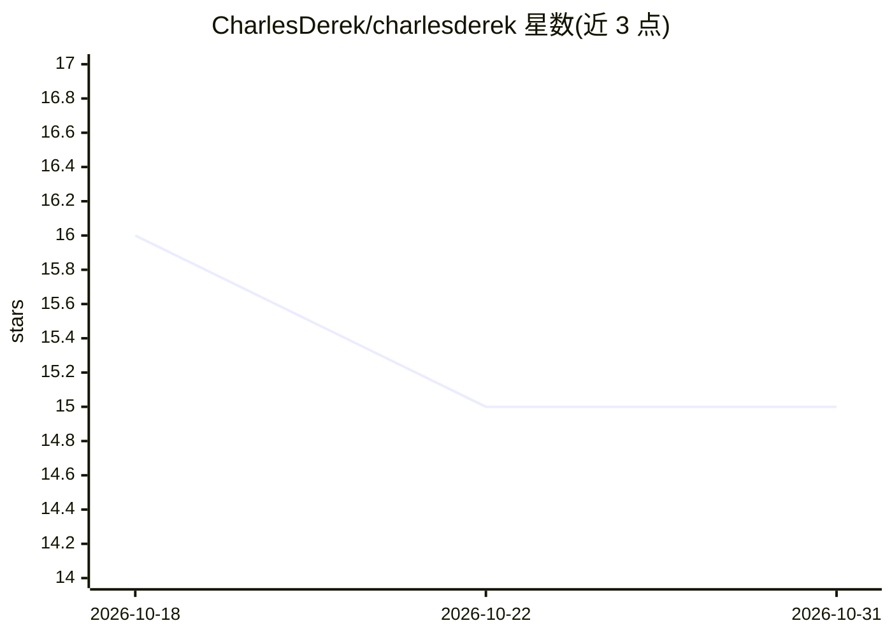

# CharlesDerek/charlesderek

⭐ 15 · 推送 2025-12-07 · [GitHub](https://github.com/CharlesDerek/charlesderek) · [官网](https://www.charlesderek.com) · 个人维护

**个人 GitHub 主页 README：安全工程师的自我介绍**

这是一个个人 GitHub 个人主页仓库的 README，内容为开发者 Charles 的自我介绍：声明其处于 VR、AI 与平台开发的交叉领域，兴趣方向包括 VR 与 AI 结合的方案、面向云与数据中心安全的可扩展系统开发，并附 LinkedIn 等社交链接与打赏入口。仓库不提供任何可安装、运行的软件产品、代码库或数据集，无安装命令、无依赖说明、无功能实现。

## 筛选速览

| 维度 | 判定 | 备注 |
|---|---|---|
| AI 角色 | `ai-knowledge` | 知识聚合/清单类 |
| 许可风险 | `none` | — |
| 部署形态 | `None` |  |
| 模型依赖 | — | README 未给出锁定关系 |
| 硬件要求 | — | 无带数字的原话,不猜 |
| 安装摩擦 | `low` | 无编译、无系统依赖或容器化 |
| 成熟度 | — | 结构信号不足 |

## 能力要点

- 个人主页介绍：VR、AI 与平台开发的交叉领域
- 兴趣方向含云与数据中心安全
- 附 LinkedIn 等外部链接与打赏入口

## 适用场景

- 了解该开发者的技术背景与兴趣方向
- 通过链接联系或关注该开发者

## 场景标签

 · 领域:个人主页/无产品

## 证据(README 行号)

> L6:  I'm Charles, a tech enthusiast at the crossroads of VR, AI, and platform development. I’m driven by creating immers
> L11:  VR & AI : Crafting transformative solutions by blending virtual reality with artificial intelligence.

## 星数曲线

2026-10-18 16 → 2026-10-31 15（-1）

---
*卡片 v1 · prompt 1.4 · 生成 2026-10-31 · 置信度 low · 依据 README sha `c99353281fd6` · [字段定义](../../DATASET.md)*
